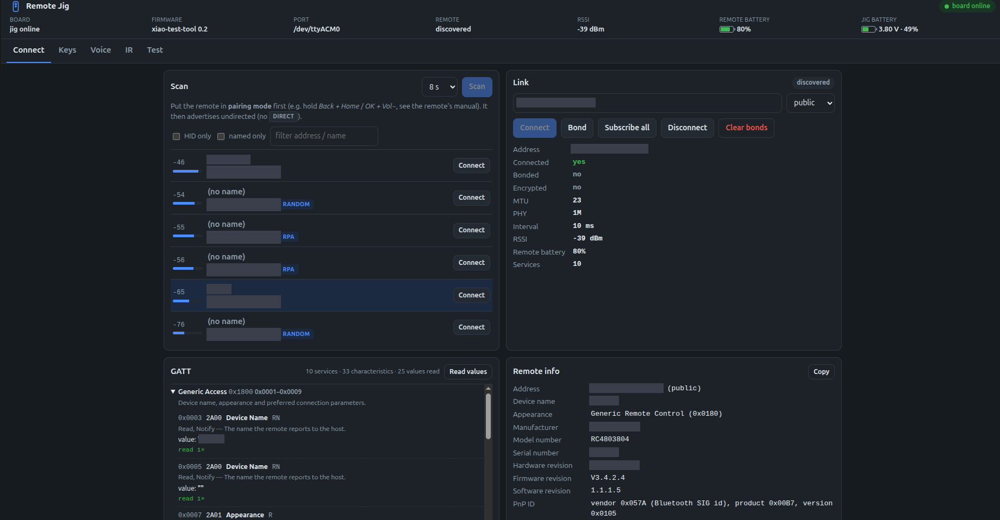
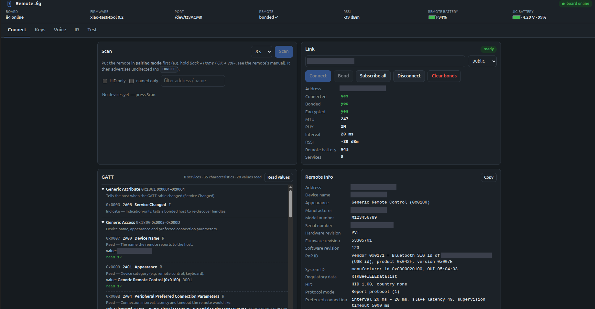
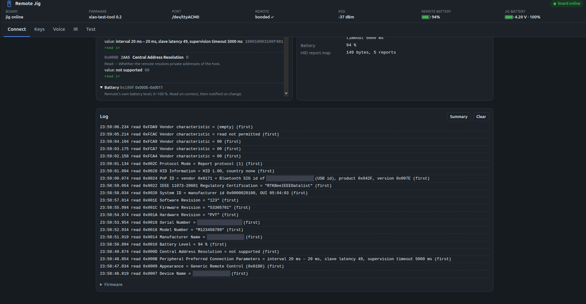

# XIAO nRF52840 Remote Test Jig

A bench test suite for TV remotes (BLE voice remotes and IR remotes) built around a single
**Seeed XIAO nRF52840**. You drive it from a browser on a PC or phone. It can:

- bond with the remote as a stand-in TV and show **decoded key presses** with latency,
- show everything the remote reports about itself (GATT table, Device Information, battery, HID
  report map), with a timestamped log you can copy or download,
- capture the remote's **voice** (Android TV Voice service) and save it as WAV,
- **receive, learn and transmit IR** through an M5Stack Unit IR,
- report the jig's **battery**,
- run a **scripted pass/fail test** and export `report.json` + a printable `report.html`,
- and, separately, let you watch a real remote⇄STB link passively in **Wireshark** with the Nordic
  sniffer firmware (no app involved, §10).

> **Full user manual:** [`doc/README.md`](doc/README.md). It covers every screen with screenshots, a
> flowchart of which firmware to use for which job, the flashing and pairing flows, troubleshooting and
> the protocol reference. This file is the condensed operator guide.

---

## Contents

1. [How it fits together](#1-how-it-fits-together)
2. [What you need](#2-what-you-need)
3. [One-time setup](#3-one-time-setup)
4. [Flashing and switching firmware](#4-flashing-and-switching-firmware)
5. [Starting the bridge and opening the app](#5-starting-the-bridge-and-opening-the-app)
6. [Pairing a remote with the jig](#6-pairing-a-remote-with-the-jig)
7. [Using each tab](#7-using-each-tab)
8. [Running a test and exporting the report](#8-running-a-test-and-exporting-the-report)
9. [Installing on a phone (PWA)](#9-installing-on-a-phone-pwa)
10. [Passive capture: Wireshark and `ble_probe.py`](#10-passive-capture-wireshark-and-ble_probepy)
11. [Battery safety](#11-battery-safety)
12. [Troubleshooting](#12-troubleshooting)
13. [Reference: files, options, protocol](#13-reference)

---

## 1. How it fits together

```
 TV remote ──BLE / IR──▶ XIAO nRF52840 ──USB serial──▶ backend/bridge.py ──WebSocket──▶ browser (PC / phone)
                         (firmware)                     (PC, port 8000)                  webapp/
```

The XIAO runs **one of two firmware images** (one at a time, chosen by flashing). The bridge and the
web app only ever talk to the first one:

| Firmware on the XIAO | What it does | Front-end |
|---|---|---|
| **xiao-test-tool** (this repo, `firmware/`) | The test jig. BLE HID *central*: bonds with the remote, so it holds the encryption keys and sees cleartext key presses. Also voice, IR and battery. | **this web app**: Connect · Keys · Voice · IR · Test |
| **Nordic nRF Sniffer 4.1** (`sniffer_nrf52840dongle_4.1.0.uf2`) | Passive capture of a real remote⇄STB link. That traffic is **encrypted** once the remote is bonded, so key presses usually can't be read this way. | **Wireshark** with the Nordic extcap plugin (§10), or `ble_probe.py`. Not the web app. |

> Why two images: sniffing cannot decrypt the remote↔STB link; that is cryptographically out of reach.
> To read keys, the jig must **be** the host. You pair the remote with the jig instead of the STB.
> If the board is running the sniffer image, the web app says so and offers to flash xiao-test-tool.
> For both roles at once, use a second XIAO that stays on the sniffer image.

### Why the XIAO nRF52840

One small board does every job in the suite, with nothing added:

- **Radio and computer on one chip.** CPU, 2.4 GHz radio, RAM/flash, USB and peripherals are all on the
  nRF52840. It connects to the remote, decodes HID, drives IR, reads the battery and talks to the PC by itself.
- **Bluetooth 5 radio.** 2M PHY, Coded PHY, Data Length Extension and Extended Advertising. Modern remotes
  switch to 2M PHY right after connecting (that is why a bare capture goes silent after connect); this
  chip follows it. Older BLE 4.x parts (nRF51) cannot see 2M traffic.
- **Same chip is the sniffer.** Nordic's nRF Sniffer firmware is built for the nRF52840, so one board
  covers both roles by reflashing: `xiao-test-tool` for active testing, the Nordic image for Wireshark.
- **Multiprotocol.** The radio also does 802.15.4 (Thread/Zigbee) and Nordic ESB/Gazell, used by many
  proprietary 2.4 GHz remotes and air-mice, so an nRF24L01 would add nothing. It does **not** cover
  sub-GHz (e.g. 433 MHz remotes); those need separate hardware.
- **On-chip peripherals fit the other jobs.**
  - IR: PWM makes the 38 kHz carrier on D1; GPIOTE timestamps received edges on D0.
  - Battery: the SAADC reads VBAT through the board's divider (P0.31, enabled by P0.14); no fuel gauge.
  - Host link: native USB enumerates as a CDC serial port at 1 Mbaud; no USB-serial chip.
- **XIAO form factor.** Tiny (fits the 46 × 23 × 14 mm case), USB-C, on-board antenna, on-board LiPo
  charger (BQ25101) and a UF2 bootloader: double-tap RST and drag a `.uf2`, no programmer needed.
- **Mature tooling.** Adafruit nRF52 Arduino BSP (used here), Zephyr / nRF Connect SDK, Nordic tools,
  the official sniffer firmware and a large community.

**In short:** the cheapest single part that is a full BLE central (cleartext keys), a Bluetooth 5 radio
that follows modern remotes and runs Nordic's sniffer, a multiprotocol 2.4 GHz transceiver, and a
microcontroller with the PWM, ADC and USB for IR, battery and the host link, on a USB-C board that
charges its own LiPo. Its only blind spot is sub-GHz.

---

## 2. What you need

- **Seeed XIAO nRF52840** (plain or Sense) and a USB-C data cable.
- Linux PC (tested on Ubuntu, Python 3.10+). macOS/Windows work for the bridge; the flashing helper
  is Linux/macOS-oriented.
- **For IR (optional):** an M5Stack **Unit IR (U002)** wired to the XIAO. See `hardware/ir_connection.svg`:

  | Unit IR wire | XIAO pad |
  |---|---|
  | Black (GND) | GND |
  | Red (5V) | **3V3** (not 5V; the nRF52840 pins are not 5V-tolerant) |
  | Yellow (IR_TX) | D1 |
  | White (IR_RX) | D0 |

- **For battery operation (optional):** a 1-cell 41 × 10 × 6 mm LiPo **with a built-in protection
  board (PCM)**, soldered to the `BAT+`/`BAT−` pads under the XIAO. It charges over USB-C (the on-board
  BQ25101 handles that). **Read §11 before soldering a cell.**
- **Enclosure (optional):** `hardware/bt_case_base.stl` + `hardware/bt_case_lid.stl` (the provided design,
  also kept in `enclosure/`). Outer ≈ 46 × 23 × 14 mm. It has a pouch channel with cradle rails, corner
  stand-offs on a shelf about 0.3 mm above the pouch (the board rests on them, so it holds the cell without
  squeezing it), a USB-C end slot, a cable slot at the far end for the Unit IR's HY2.0 lead, and a flush
  friction lid. Put soft pads (TPU or 1 mm silicone bumpers) on the stand-offs and keep the hard spacer
  between pouch and USB-C slot (§11).

  `hardware/bt_case.scad` is a parametric alternative for other parts. It renders `bt_case_param_base.stl`,
  `bt_case_param_lid.stl` (notched over the USB-C receptacle) and `bt_case_param_pads.stl` (four
  3 × 3 × 1 mm pads, print in TPU), for example `openscad -D 'part="base"' -o hardware/bt_case_param_base.stl
  hardware/bt_case.scad`. Check the fit against your parts before printing. The Unit IR mounts **outside**
  the case, facing the remote.

---

## 3. One-time setup

All tools install **inside this folder** (`.venv/`, `.toolchain/`). Nothing goes into `~/.arduino15`.

### 3.1 Python environment

```bash
cd BT-Sniffer
python3 -m venv .venv
.venv/bin/pip install -r requirements.txt     # aiohttp, pyserial, intelhex, adafruit-nrfutil
```

`requirements.txt` includes `backend/requirements.txt`, so either file works. Nordic's SnifferAPI is not
on PyPI. It is vendored in `extcap/SnifferAPI/`, and `ble_probe.py` and the bridge find it there.

### 3.2 Serial port permission (Linux)

```bash
sudo usermod -aG dialout $USER      # then log out and back in
```

### 3.3 Firmware toolchain (only needed to rebuild the firmware)

A prebuilt UF2 is produced in `firmware/xiao_test_tool/build/`. To build it yourself:

```bash
mkdir -p .toolchain/bin && cd .toolchain
curl -fsSL https://github.com/arduino/arduino-cli/releases/download/v1.1.1/arduino-cli_1.1.1_Linux_64bit.tar.gz | tar xz -C bin arduino-cli
cat > arduino-cli.yaml <<EOF
board_manager:
  additional_urls: [https://files.seeedstudio.com/arduino/package_seeeduino_boards_index.json]
directories:
  data: $PWD/data
  downloads: $PWD/staging
  user: $PWD/user
EOF
bin/arduino-cli --config-file arduino-cli.yaml core update-index
bin/arduino-cli --config-file arduino-cli.yaml core install Seeeduino:nrf52      # Seeed nRF52 Boards 1.1.x
bin/arduino-cli --config-file arduino-cli.yaml lib install ArduinoJson           # 7.x
cd ..
firmware/build.sh
```

`build.sh` writes two files:

- `xiao_test_tool_full.uf2`: **S140 SoftDevice + app. Use this one.** The Nordic sniffer image
  overwrites part of the SoftDevice, and this file restores it.
- `xiao_test_tool.uf2`: app only (fine if the board already runs xiao-test-tool).

---

## 4. Flashing and switching firmware

The XIAO has a UF2 bootloader: in bootloader mode it appears as a USB drive (named **`XIAO-BOOT`**,
or **`XIAO-SENSE`** on boards shipped with the Sense bootloader) and you copy a `.uf2` onto it.

### 4.1 With the helper (recommended)

Stop the bridge first (it holds the serial port), then:

```bash
.venv/bin/python backend/flash.py tool       # install xiao-test-tool
.venv/bin/python backend/flash.py sniffer    # install the Nordic sniffer (for Wireshark, §10)
```

- **From the sniffer → tool:** the sniffer firmware has no way to enter the bootloader by itself.
  When the script says *"Double-tap the RST button"*, **double-tap RST quickly** (the LED pulses
  and the drive appears). The script waits up to 3 minutes (`--wait 600` for longer), copies the
  UF2, and the board reboots.
- **From the tool → anything:** no button needed. The script sends the firmware a `dfu` command,
  the board enters the bootloader by itself, and the copy happens automatically.

The web app can do this too: **Connect tab ▸ Firmware ▸ Flash Nordic sniffer (for Wireshark) / Re-flash
xiao-test-tool**. When the sniffer image is running, the banner shows a **Flash xiao-test-tool** button.

### 4.2 By hand

1. Double-tap **RST** → the `XIAO-BOOT` / `XIAO-SENSE` drive appears.
2. Copy `firmware/xiao_test_tool/build/xiao_test_tool_full.uf2` (or the sniffer `.uf2`) onto it.
3. The board reboots by itself. (A "write error" at the very end is normal: the board resets as soon
   as the last block lands.)

Bonds with remotes are stored in a flash area that flashing does **not** touch, so they survive a reflash.

---

## 5. Starting the bridge and opening the app

```bash
.venv/bin/python backend/bridge.py
```

It finds the XIAO (usually `/dev/ttyACM0` or `/dev/ttyACM1`), checks that it runs xiao-test-tool, and
prints the addresses it serves on:

```
bridge: serving web app: http://localhost:8000  http://192.168.1.26:8000
bridge: detected tool firmware on /dev/ttyACM1
```

Open **http://localhost:8000** on the PC, or **http://&lt;PC-IP&gt;:8000** from a phone on the same Wi-Fi.
Leave the bridge running: unplugging, replugging or reflashing the board is handled automatically.

The banner at the top always shows: bridge link (green = board online), **board** (jig online /
sniffer image / none), firmware, serial port, remote link state, RSSI, the **remote's battery** and the jig battery (marked
**LOW** below 3.4 V, §11).

The remote battery comes from the remote's standard Battery Service (0x180F, Battery Level 0x2A19,
0–100 %). The jig reads it right after the link is encrypted, and enables its notifications (CCCD
0x0001) so the remote pushes a new value whenever the level changes. Hover the gauge to see whether
the last value was read or notified, and when. While the remote is disconnected, the last value
stays visible, dimmed and marked "(last)".

If the XIAO is running the Nordic sniffer image, the bridge doesn't drive it. The app shows a hint:
flash xiao-test-tool (one button), or use Wireshark for passive capture (§10). The bridge doesn't hold
the port open in that state, so Wireshark can use it.

Useful options (all also settable through environment variables, see §13):

```bash
backend/bridge.py --port /dev/ttyACM1      # skip auto-detection
backend/bridge.py --http-port 8080
backend/bridge.py --simulate               # no hardware: a simulated xiao-test-tool (for demos/training)
backend/bridge.py --https                  # also serve HTTPS on :8443 (needed to install on phones, §9)
```

---

## 6. Pairing a remote with the jig

This is the key workflow: the jig takes the TV's place so it receives the remote's keys in cleartext.

> **Note:** pairing bonds the remote **to the jig**. Many remotes remember only one host, so you may
> need to re-pair it with the set-top box after testing.

### 6.1 First-time pairing

1. **Switch the set-top box OFF** (unplug it), or move it out of range. Otherwise the remote may
   reconnect to the STB instead.
2. In the app, open **Connect** and press **Scan** (8 s).
3. Put the remote into **pairing mode** and keep it within about 1 m:
   - **Android TV voice remotes:** usually hold **Back + Home** (or **OK + Vol−**) for about 5 s, until
     the LED blinks continuously.
   - **Fire TV remotes:** hold **Home** for about 10 s. If it still shows **NOT PAIRING**, factory-reset
     it first: hold **Left + Menu + Back** for 12 s, release, wait 5 s, then hold **Home**.
4. The remote appears in the list with a green **PAIRING** badge (and the decoded advert below its
   name). **NOT PAIRING** means it only accepts its own host, and connecting fails with 0x3E.
   Tap the row's **Pair**.
5. Pair does everything in one step:
   - **connect:** it retries twice if the remote misses the connection, which is common;
   - **pair fresh:** any old bond is deleted first; if the remote demands a passkey, a 6-digit code to
     type on the remote appears;
   - **read and subscribe.**

   The Connect log shows every stage, the link parameters and the result.
6. **Ready** means: bonded ✓, encrypted ✓, the HID report map was read, and the jig subscribed to keys, voice
   and battery. The banner shows **bonded ✓ live** once the remote sends something. Remotes without the
   Android TV voice service show **bonded ✓ · press a key** until you press one. The blue LED is on while
   connected.
7. The remote is now the session's **locked** remote: the jig reconnects only to it, so other bonded units
   on the bench can't take over. See **Connect ▸ Link ▸ Bonded remotes** (🔒 lock, ✕ forget, Unlock).

**Connect** + **Bond** still exist as separate steps for diagnosis.

### 6.2 Reconnecting: remotes differ

How a remote behaves when it reconnects with the stored bond (after a jig reboot, an idle drop, or a
key press that wakes it) depends on the model:

| Remote | Reconnect with stored keys | What to do |
|---|---|---|
| **Fire TV remote**, tested 2026-10-27 | works: keys and battery keep coming | press any key to wake it; no re-pairing |
| **Android TV voice remote**, tested 2026-10-26 | link comes up but stays **silent** | pairing mode at the start of each session (below) |
| **LG Magic Remote**, tested 2026-10-29 | works | keys travel inside its 100/s motion stream as LG IR codes; the bridge decodes them (`backend/lg_magic.py`). Unknown codes show as `LG_0x..`. |

#### One pairing per session (Android TV voice remote)

Observed on the Android TV voice remote:

- A link made by a **fresh pairing** works and stays up. Keys and voice kept flowing after more than
  7 minutes untouched; the remote did not drop it.
- Any link the remote makes by **reconnecting with stored keys** stays **silent**. That covers a jig
  reboot or reflash, a jig that dropped the link, and pairing mode met with the old keys. The link
  encrypts and subscriptions succeed, but the remote sends nothing: no keys, no voice, no reply to the
  voice handshake. Re-pairing over such a link doesn't help either. Why the remote does this is not
  visible from the jig; it would need a passive capture (§10).

The firmware handles this on its own:

1. **Silent-link check.** About 3 s after setting up a link (after pairing finishes, if one is
   running), the jig checks whether the remote answered the voice handshake (`GET_CAPS`), which a
   working link always does within milliseconds. This check runs only on remotes with the Android TV
   Voice service; other remotes are marked live on their first notification.
   - **Silent:** the banner shows **silent ⚠**, a warning appears, `state.live` is `false`, and the
     jig drops the link.
   - **Working:** `state.live` turns `true`.
2. **Fresh-pair mode.** After a silent link, the jig ignores the remote's directed reconnects, which
   would only give another silent link and keep the remote out of real pairing mode. It waits for the
   undirected pairing-mode advert.
3. **Pairing mode always pairs fresh.** On an undirected advert from the bonded remote, the jig deletes
   the old bond and pairs from scratch. It doesn't reuse the stored keys, because the Bluefruit stack
   would answer the remote's security request with them and the link would be silent again.

So in practice: **start every session by putting the remote in pairing mode, with the STB off.** Wait
for the blue LED and **live** status, and keys and voice work until you stop. If the jig reboots or the
link drops, the banner shows **silent ⚠** or idle. Put the remote in pairing mode again and the jig
re-pairs by itself; you don't need to press anything in the app.

After a jig reboot with **no** bond stored (for example after **Clear bonds**), the jig doesn't scan by
itself. Use **Connect ▸ Scan → Connect → Bond** as in §6.1.

If the Connect log says *"bonded remote is advertising directed to XX:… which is not the jig"*, the
remote is trying to reach **another** host it is bonded with (normally the STB). Switch the STB off and
use pairing mode.

### 6.3 Removing the bond

**Connect ▸ Clear bonds** makes the jig forget all remotes. Do this if you want to pair from scratch,
for example after the remote was factory-reset.

### 6.4 About addresses

The jig shows addresses in standard Bluetooth order (most significant byte first). Older
`ble_probe.py` output and `BT-sniffed.txt` printed every address **byte-reversed**; that bug is fixed.

---

## 7. Using each tab

### Connect

Screenshots from a bench session (addresses, names, vendor and serial numbers masked; taken with
firmware 0.2, so the Pair button, newer badges and the *Remotes only* filter are not shown yet):

| Scan → connect | Bonded remote, GATT and Remote info | GATT reads in the Log |
|---|---|---|
| [](doc/images/readme/connect-scan.png) | [](doc/images/readme/connect-bonded.png) | [](doc/images/readme/connect-log.png) |

- **Scan** lists nearby devices by signal strength. Badges: **HID** (keyboard/remote service),
  **DIRECT** (directed advert aimed at a specific host), **RPA / RANDOM / NRPA** (address type),
  **PAIRING** / **NOT PAIRING** (whether a remote's advert flags say it is discoverable; a remote
  that is NOT PAIRING only accepts its own host and connections from the jig fail with 0x3E),
  **BONDED** (the jig holds a bond with it). Under each name, a decoded advert line shows flags,
  appearance, maker (Bluetooth company ID), services and TX power.
  Filters: *Remotes only* (HID, remote appearance, or bonded), *named only*, text search. **Pair** on a row
  pairs that remote in one step.
- **Link** panel: **Pair** / Connect / Bond / Subscribe all / Disconnect / Clear bonds, plus the live link
  details: bonded, encrypted, MTU, PHY, connection interval, RSSI, the remote's own battery %, service count,
  **Live** (sending / unknown / SILENT) and **Session lock**. **Bonded remotes** lists every bond with
  lock / forget buttons. A passkey box appears if a remote demands passkey pairing.
- **Remote info** collects what the remote says about itself in one list:
  - **Identity:** address, device name, appearance, manufacturer.
  - **Versions:** model, serial, hardware/firmware/software revision.
  - **IDs:** PnP ID (vendor/product/version), System ID, regulatory data.
  - **HID and power:** HID version, protocol mode, preferred connection parameters, battery, report-map size.

  The values come from the GATT reads below, so nothing is read twice. **Copy** puts the list on the
  clipboard. After a disconnect it keeps showing the last connection.
- **GATT** explains everything the remote exposes:
  - **Names and properties:** every service and characteristic with its name and purpose, and the
    property letters spelled out (R Read, W Write, w Write without response, N Notify, I Indicate).
  - **Values:** each readable value, decoded. That includes device name, appearance, preferred
    connection parameters, the Device Information strings, PnP vendor/product, HID information,
    protocol mode and battery.
  - **HID report map:** decoded, so each Report shows which keys it carries.
  - **Reading:** values are read once each time the remote reaches *ready*; **Read values** reads
    them again.
  - **Tally:** under each characteristic, how often it was read and notified, when it last arrived
    and the average interval.
- **Log** (full width, at the bottom) shows firmware and bridge messages, plus one line per GATT exchange:
  - **read:** the jig asked.
  - **notify:** the remote sent it by itself, for example a battery level change.

  Each line has the decoded value and the time since the previous exchange on that characteristic.
  Key presses and voice frames are counted in the tally instead of logged line by line.
  **Summary** opens a live table above the log (reads, notifications, last seen, average interval per
  characteristic) with its own **Copy**; **✕ Close** or **Hide summary** closes it. The log itself is not changed.
  **Save to file** (tick box) keeps a **persistent session log** on the PC. The bridge writes
  `reports/logs/session_<date-time>.log` in the background, with a new file each time you tick it, and keeps
  writing with no browser open. Each line has a timestamp: commands sent, state changes, decoded keys,
  GATT reads, battery and log messages. Voice is summarised per stream; the keep-alive pings and RSSI-only
  updates are left out. The current file name is shown next to the box (click to open). To start logging
  when the bridge starts, use `bridge.py --session-log`.
  **Copy** and **Download** export the whole session log, up to 20 000 lines, even though the screen
  shows only the newest 300. Lines run oldest first, each with date and time, under a header with
  the jig firmware and port and the remote's address, name, model and firmware. The download is
  named `remote-log_<address>_<date-time>.txt`. Copy also works from a phone over plain http.
  **Firmware** switches the image (§4).

### Keys
- The **visual remote** lights up the button that was pressed; buttons already seen turn green.
  Dashed buttons are optional in the test.
- **Key log**: time, handle, raw report bytes, decoded usage (e.g. `VOLUME_UP`, `DIGIT_5`), HID page,
  press ↓ / release ↑, and latency.
- **Latency** (last / avg / p95 / max): the time from the firmware receiving the notification to the row
  appearing on screen. It covers USB, bridge, network and rendering. The radio adds up to one connection
  interval, shown under the numbers. Values under 50 ms are green.
- **Buttons seen**: a checklist of the expected buttons, plus any extra codes received.
- **Map key**: for buttons that send a vendor-specific code. Examples:
  - the Android TV voice remote's app shortcut keys send consumer codes `0x68` and `0x72`;
  - the Fire TV remote sends `0xF1` (keyboard page) for Back and `0xA1`–`0xA4` on vendor report 239 for
    its app buttons.

  Tap **Map key**, tap the button on the drawing, then press the physical key. The mapping is saved in
  that browser.

### Voice
- **Open mic** / **Close mic** ask the remote to start or stop streaming. Normally you just **hold the remote's mic
  button**: the jig answers the Android TV Voice service like a TV would.
- The indicator turns red while streaming; the level meter, notifications/s and throughput update live.
- **● Record** collects frames until you press **■ Stop**. **Save WAV** decodes them (IMA-ADPCM; the sample
  rate, 8 or 16 kHz, is worked out from the stream's byte rate — the Android TV voice remote sends 16 kHz) and
  offers an audio player plus downloads of the **WAV** and the **raw** bytes. The raw file is always saved,
  even if decoding fails. Without a recording, Save uses the last voice stream.
- Files are written to `reports/voice/`.
- **Fire TV remotes** are not supported for voice yet. Their mic button arrives as a `SEARCH` key. Audio
  goes through Amazon's own GATT services (`FE151500-…`, `5DE20000-…`, `CFBFA000-…`), whose protocol
  is not public. The jig subscribes to them and forwards any notifications as raw voice frames, but the
  remote waits for a start command the jig doesn't know yet.

### IR (needs the Unit IR wired, §2)
- **Receive**: every frame the Unit IR receives is listed with protocol (NEC, SIRC, RC5 or UNKNOWN), address,
  code, a repeat flag and its mark count. **RX on** toggles the receiver.
- **Learn next frame**, then point any IR remote at the Unit IR and press a key: the frame is stored under
  **Learned** (rename it, **Send** it, **Raw** to replay the exact timings, ✕ to delete). **Keep** on a received row
  does the same.
- **Send**: transmit NEC or SIRC by address and code (e.g. NEC `0x04` / `0x08`), with optional repeats.
  The status shows when transmission finished.

---

## 8. Running a test and exporting the report

1. Pair the remote (§6) so the banner shows **bonded ✓**.
2. Open **Test**, fill in **DUT label** (e.g. remote serial number) and **Operator**.
3. Optional: **Settings** sets battery limits, voice frame count, key-latency limit, IR address/code, timeouts.
4. Press **Run all**. Follow the **Current step** panel (shown first on phones):

   | Step | What you do | Pass when |
   |---|---|---|
   | BLE link | nothing | remote connected and encrypted |
   | Keys | press every button shown in the list | every expected button decoded (and max latency ≤ limit) |
   | Voice | hold the mic button and speak | a voice stream of ≥ N frames arrives |
   | IR loopback | TX and RX share the Unit IR: hold a white card or other reflective surface a few cm in front of it | the transmitted NEC frame is received back |
   | Battery | nothing | jig VBAT is within limits |

   Each step also has **Mark pass / Mark fail / Skip** buttons for the operator, and **▶** reruns a single step.
   **Abort** stops the run.
5. Press **Export report**. The bridge writes `reports/report_<date-time>.json` and `.html`; links appear in the app.
   Open the HTML and print it (or save it as PDF) for the record.

---

## 9. Installing on a phone (PWA)

Plain `http://<PC-IP>:8000` works in any phone browser. To **install it as an app** (full screen, offline shell),
phones require HTTPS:

1. Start the bridge with `--https`. It creates a local certificate authority in `.certs/` and serves
   `https://<PC-IP>:8443`.
2. On the phone, open **http://&lt;PC-IP&gt;:8000/ca.crt** and install it:
   - **Android:** Settings ▸ Security ▸ Encryption & credentials ▸ Install a certificate ▸ CA certificate.
   - **iOS:** install the downloaded profile (Settings ▸ General ▸ VPN & Device Management), then enable it under
     Settings ▸ General ▸ About ▸ Certificate Trust Settings.
3. Open **https://&lt;PC-IP&gt;:8443**, then *Install app* (Chrome) or *Share ▸ Add to Home Screen* (Safari).

Only install this CA on devices you control; delete `.certs/` to generate a new one.

---

## 10. Passive capture: Wireshark and `ble_probe.py`

Watching the **production** link (the remote bonded to the STB) is an occasional diagnostic and is
**not** part of the web app. The Nordic sniffer firmware comes with a Wireshark **extcap** plugin. It
follows the switch to 2M PHY and the connection/channel-map updates (the reason bare `ble_probe.py`
goes quiet after a connect), and gives you full BLE dissectors plus a field for decryption keys.

```bash
# 1. flash the Nordic sniffer image onto the XIAO (stop the bridge first):
.venv/bin/python backend/flash.py sniffer
#    or by hand: double-tap RST -> drag sniffer_nrf52840dongle_4.1.0.uf2 onto XIAO-BOOT / XIAO-SENSE
# 2. install the extcap plugin (Wireshark ▸ Help ▸ About ▸ Folders ▸ "Personal Extcap path" shows the dir):
mkdir -p ~/.local/lib/wireshark/extcap
cp -r extcap/nrf_sniffer_ble.py extcap/nrf_sniffer_ble.sh extcap/SnifferAPI \
      ~/.local/lib/wireshark/extcap/
chmod +x ~/.local/lib/wireshark/extcap/nrf_sniffer_ble.sh ~/.local/lib/wireshark/extcap/nrf_sniffer_ble.py
pip install pyserial            # for the Python that Wireshark runs the plugin with
# 3. restart Wireshark -> choose the interface "nRF Sniffer for Bluetooth LE",
#    open View ▸ Interface Toolbars ▸ nRF Sniffer for Bluetooth LE, pick the remote's address
#    as the device to follow, and enable following on all PHYs.
```

To catch a connection being set up, choose the remote **before** it connects (for example, then
power-cycle the STB). Once the link is encrypted, only metadata is visible. With LE Secure Connections
that can't be avoided. With legacy pairing, Wireshark can decrypt the traffic if the capture includes
the pairing itself, e.g. while you re-pair the remote. When you're done, flash xiao-test-tool back (§4).

`ble_probe.py` is a lightweight terminal alternative for the same passive role:

```bash
.venv/bin/python ble_probe.py                          # scan, choose a device, follow it
.venv/bin/python ble_probe.py --address AA:BB:CC:DD:EE:FF
.venv/bin/python ble_probe.py --name RCU --raw
```

It uses the decoder in `backend/decode.py`. Three bugs from the original are fixed there: packet types
were decoded from the wrong bytes, device addresses were printed byte-reversed, and the master/slave
direction labels were swapped.

---

## 11. Battery safety

Read this before soldering a cell. Protection comes from three different places:

| Failure mode | Protected by | Automatic? |
|---|---|---|
| **Overcharge** (> 4.2 V) | the on-board BQ25101 charger (CC/CV, termination, safety timer) | yes, no code |
| **Over-discharge** (cell drained too low) | the **cell's own PCM**, *not* the XIAO | only if the cell has one |
| **Over-current / short** | the **cell's own PCM**, *not* the XIAO | only if the cell has one |
| **Low-battery soft warning** | the firmware and the app (below) | yes |

The BQ25101 is a **charger, not a protection circuit**. So:

- **Always use a LiPo with a built-in protection board (PCM).** With that and the on-board charger,
  overcharge, over-discharge and shorts all cut off in hardware. A **bare** cell has none of this.
  Don't use one.
- The firmware adds a soft, earlier limit, never the only safeguard:
  - Below **3.4 V** the `battery` event carries `"low":true`. The banner marks the battery **LOW** and
    shows a one-time toast.
  - Below **3.3 V** (`"cut":true`) the firmware refuses IR transmit, the heaviest load, until the cell
    recovers to 3.4 V.
  - Readings under 2.5 V are treated as "no cell fitted" (USB only) and don't trigger the cut.

The electronics do **not** cover these risks. They are the actual fire sources:

1. **Reverse polarity when soldering** `BAT+ / BAT−`. Swapping them can destroy the charger and stress the
   cell. Check three times before first power-up; this is the most likely way to start a fire here.
2. **Mechanical damage or compression** of the pouch inside the case. A punctured or creased cell can short
   internally and ignite whatever protection it has. The case keeps the PCB on soft stand-offs 0.3 mm above the
   pouch and puts a hard spacer between the pouch and the USB-C slot. Make sure there are no sharp edges
   (deburr the print).
3. **Soldering heat on the tabs.** Solder quickly to the PCM pads or leads, and never heat the cell body.
4. **A swollen or damaged cell.** Never charge one; the charger can't detect it. Throw it away safely.

The XIAO's default charge current is low (~50 mA, set by an on-board resistor). That is conservative and
fine for a small pouch. **Don't** raise it unless the cell's datasheet rates a higher charge current.

---

## 12. Troubleshooting

Messages with a numeric code explain it themselves. For example,
`disconnected (reason 0x08 = Connection Timeout: link lost — …)`. The bridge looks up every HCI disconnect
reason, SMP pairing failure, GATT status and nRF error (`backend/reason_codes.py`). Full tables:
`doc/11-reference.md` ▸ Reason and error codes, or `.venv/bin/python -m backend.reason_codes`.

| Symptom | Fix |
|---|---|
| Banner says **offline** | The bridge isn't running, or the page was opened from a different host/port. Start `backend/bridge.py`. |
| **no board** | Plug in the XIAO. Check `ls /dev/ttyACM*`. Permission denied → §3.2. If you just double-tapped RST, the board is in the bootloader; flash it or press RST once. |
| Banner says **sniffer image** | The Nordic sniffer is flashed. Press **Flash xiao-test-tool** in the hint (double-tap RST when asked), or use Wireshark (§10). |
| Remote not in the scan list | It isn't in pairing mode (pairing mode times out after ~30–60 s; retry), or it is already connected to something. Turn the STB off. |
| Remote shows only with **DIRECT** | It is trying to reconnect to a host it's bonded with. Put it in pairing mode. |
| **connect timed out** | The remote stopped advertising, or the advert was directed at another host. Retry in pairing mode. |
| Connects, then **disconnected (reason 0x3E)** at once / scan shows **NOT PAIRING** | The remote is only reconnecting to its own host and ignores the jig. Unplug that host and put the remote in real pairing mode (§6.1); a Fire TV remote may need a factory reset first. |
| **pairing failed** | Press Clear bonds, put the remote back in pairing mode, Connect, Bond. |
| Log: *ignoring bonded remote …: the session is locked to another remote* | Intended: the jig stays with the locked remote. **Pair** the new one, or use 🔒 / Unlock under Connect ▸ Link ▸ Bonded remotes. |
| *pair: gave up — is the remote in pairing mode?* | Three connection attempts went unanswered. Look for the **PAIRING** badge; pairing mode times out after ~30–60 s. |
| A passkey box appears | The remote refused Just Works pairing (0x83): type the 6 digits on the remote, then OK / Enter. |
| Keys stop / banner shows **silent ⚠** | This remote only sends on a freshly paired link (§6.2). Put it in pairing mode (STB off); the jig re-pairs by itself. |
| Fire TV remote: keys stop after a while | It dropped the link to save power. Press any key; it reconnects within a second. |
| Key shows as `0x…` | A vendor-specific code. Use **Keys ▸ Map key**, or add it to `backend/hid_usage.py` (then `firmware/build.sh` to update the firmware's names). |
| No voice | Hold the mic button (not just tap). Check that **Connect ▸ GATT** shows an *Android TV Voice* service with voice roles. Try **Voice ▸ Open mic**. Fire TV remotes: not supported yet (§7 Voice). |
| IR: nothing received | Check the wiring (§2; IR_RX → D0, power from 3V3), that **RX on** is ticked, and aim the LED at the receiver. |
| Battery reads ~4.2 V with no battery | Normal: without a LiPo the VBAT pin sees the charger output. |
| Battery **LOW** / IR TX refused | The jig cell is below 3.4 V / 3.3 V (§11). Charge over USB-C. |
| Flash helper waits forever | Double-tap RST faster (two taps within ~0.5 s). The drive may be named `XIAO-SENSE`; the helper handles both names. |

---

## 13. Reference

### Files

| Path | Purpose |
|---|---|
| `backend/bridge.py` | Entry point: serial ⇄ WebSocket bridge and web server |
| `backend/tool_proto.py` | xiao-test-tool JSON line protocol (encode/parse, serial link, probe) |
| `backend/decode.py` | BLE PDU decoders used by `ble_probe.py` |
| `backend/hid_usage.py` | HID usage → key-name tables (source of the firmware's `usage_names.h`), report-map parser |
| `backend/adpcm.py` | IMA-ADPCM → WAV for voice |
| `backend/report.py` | Test report model, JSON + HTML export |
| `backend/flash.py` | Firmware switching via the UF2 bootloader |
| `backend/sim_device.py` | Simulated firmware for `--simulate` |
| `webapp/` | The web app (no build step); `js/gatt_info.js` holds the GATT names, value decoders and report-map parser |
| `firmware/xiao_test_tool/` | Firmware source. Its README covers pins, protocol extras and design notes. |
| `firmware/build.sh`, `firmware/make_uf2.py` | Build and UF2 packaging (with SoftDevice) |
| `hardware/` | IR wiring diagram, enclosure STLs (provided), parametric `bt_case.scad` → `bt_case_param_*.stl` |
| `extcap/` (incl. `extcap/SnifferAPI/`), `ble_probe.py` | Passive capture with the Nordic image (Wireshark plugin, CLI) (§10) |
| `reports/` | Exported reports and voice captures |
| `requirements.txt`, `backend/requirements.txt` | Python dependencies (the root file includes the backend one) |
| `CLAUDE.md` / `OPENCODE.md` | Build brief for the coding agents (kept locally, not in git) |

### Bridge options

| Flag | Env var | Default |
|---|---|---|
| `--port` | `BRIDGE_PORT` | auto-detect |
| `--http-port` | `BRIDGE_HTTP_PORT` | 8000 |
| `--bind` | `BRIDGE_BIND` | 0.0.0.0 |
| `--baud` | `BRIDGE_BAUD` | 1000000 |
| `--https`, `--https-port` | `BRIDGE_HTTPS_PORT` | off, 8443 |
| `--reports` | `BRIDGE_REPORTS` | `./reports` |
| `--simulate` | | off |
| `--session-log` | `BRIDGE_SESSION_LOG=1` | off (start persistent logging at launch) |

### Pins (xiao-test-tool)

| Function | Pin |
|---|---|
| IR receive (Unit IR white) | D0 / P0.02 |
| IR transmit, 38 kHz (Unit IR yellow) | D1 / P0.03 |
| Battery sense | P0.31 via the on-board 1 MΩ / 510 kΩ divider; P0.14 held LOW |
| Blue LED | on while a remote is connected |

### Protocol

The firmware speaks one JSON object per line over USB serial at 1 000 000 baud. The bridge passes
everything through to the web app over the WebSocket, adding `"src":"tool"`. Events the bridge re-sends
from its cache to a newly opened page also carry `"cached":true`.

**Commands (host → firmware)**

| Command | Purpose |
|---|---|
| `{"cmd":"ping"}` | reply with `hello` |
| `{"cmd":"scan","sec":6}` | scan (`0` = until `scan_stop`) |
| `{"cmd":"scan_stop"}` | stop scanning |
| `{"cmd":"connect","addr":"AA:BB:CC:DD:EE:FF","atype":"public"}` | connect (`random` / `public`) |
| `{"cmd":"pair","addr":"AA:BB:CC:DD:EE:FF","atype":"public"}` | one step: connect → pair fresh → subscribe; retries a missed connection twice; locks the session to it |
| `{"cmd":"bond"}` | pair and bond (Just Works; passkey fallback on 0x83) |
| `{"cmd":"lock","addr":"…"}` / `{"cmd":"unlock"}` | follow only this remote / any bonded remote (persisted) |
| `{"cmd":"bonds"}` / `{"cmd":"bond_delete","addr":"…"}` | list bonds / forget one remote |
| `{"cmd":"disconnect"}` | drop the link |
| `{"cmd":"subscribe","what":"all"}` | enable notifications: `hid` / `voice` / `battery` / `all` |
| `{"cmd":"battery"}` | jig battery + read the remote's Battery Level |
| `{"cmd":"state"}` | emit `state` |
| `{"cmd":"info"}` | re-send `gatt`, `hid` and `state` for the current link (used by the bridge on start-up) |
| `{"cmd":"gatt_read","handle":"0x0016"}` | read a characteristic → `gatt_read` |
| `{"cmd":"gatt_write","handle":"0x0052","bytes":"0c0001","rsp":true}` | raw write |
| `{"cmd":"mic","on":true}` | Android TV Voice MIC_OPEN / MIC_CLOSE |
| `{"cmd":"repair"}` | run pairing again on the live link |
| `{"cmd":"clear_bonds"}` | forget all bonded remotes |
| `{"cmd":"ir_rx","on":true}` | IR receiver on/off |
| `{"cmd":"ir_tx","proto":"NEC","addr":"0x04","code":"0x08"}` | send NEC (or `SIRC`) |
| `{"cmd":"ir_tx_raw","carrier":38000,"timings":[9000,4500,560,560]}` | send raw mark/space µs |
| `{"cmd":"mode","value":"both"}` | `ble` / `ir` / `both` |
| `{"cmd":"dfu"}` | reboot into the UF2 bootloader (used by `flash.py`) |

**Events (firmware → host)**

| Event | Content |
|---|---|
| `hello` | `fw`, `ver`, `roles`, jig `addr`, `bonds`, `mode` |
| `scan` | `addr`, `atype`, `rssi`, `name`, `hid`, `appearance`, `bonded`, `directed` (+ `target`, `to_jig`), `connectable`, `adv` (advert hex, carries the Flags), `rsp` (scan response hex) |
| `state` | `conn`, `stage` (`idle` → `connecting` → `connected` → `discovering` → `discovered` → `pairing` → `reading` → `ready`), `addr`, `bonded`, `secured`, `mtu`, `phy`, `rssi`, `interval_ms`, `services`, `ntf` (notifications on this link), `live` (`false` = silent link, §6.2), `lock` (session lock), `bonds` (count) |
| `gatt` | every service and characteristic: `uuid`, `handle`, `props`, `role`, HID `report_id` / `report_type` |
| `hid` | report map (hex), length, report handles and IDs |
| `gatt_read` | `handle`, `ok`, `bytes` |
| `link` | connection-parameter / PHY / data-length / MTU changes (`what` + values) |
| `bonds` | bonded remotes: identity `addr`, `rpa`, `locked`, `connected` |
| `passkey` | 6-digit `code` to type on the remote |
| `key` | `handle`, `report` (hex), `usage` (name, or `0x..` if unknown), `page`, `rid`, `down` |
| `battery` | `which:"jig"`: `mv`, `pct`, `low`, `cut` (§11) · `which:"remote"`: `pct`, `via` (`read` / `notify`) |
| `voice`, `voice_ctl`, `voice_state` | audio frames (hex) · voice control events · stream start/stop |
| `notify` | notification from a characteristic with no known role |
| `hid_data` | HID report with no key usages (vendor data such as motion); LG Magic Remote keys are decoded from it by the bridge |
| `ir`, `ir_tx_done` | received IR frame (`proto`, `addr`, `code`, `repeat`, `raw`) · transmit finished |
| `scan_done`, `log` | as named |

You can talk to the firmware directly with any serial terminal (stop the bridge first), e.g.
`.venv/bin/pyserial-miniterm /dev/ttyACM0 1000000`, then type `{"cmd":"ping"}`.
