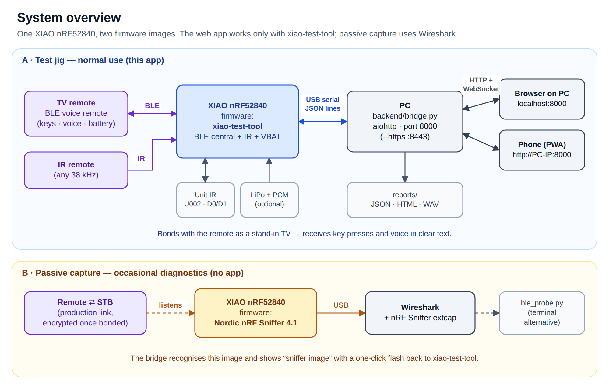
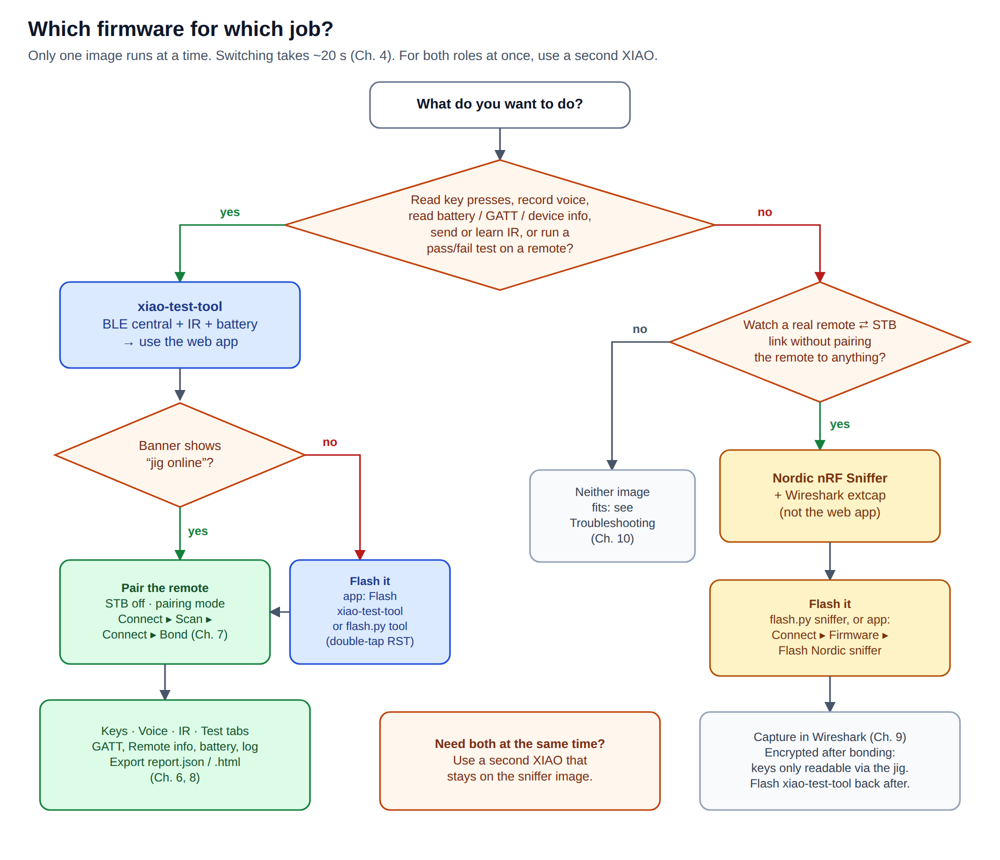
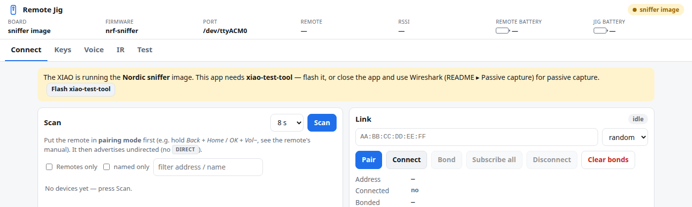

# 1 · Overview

[← Manual index](README.md) · [Next: Hardware →](02-hardware.md)

## What the jig does

The **Remote Test Jig** takes the place of the TV or set-top box (STB) on a bench. With it you can:

- pair with a BLE TV remote and see every **key press decoded** (`VOLUME_UP`, `HOME`, `DIGIT_5` …)
  with its latency;
- read everything the remote reports about itself: **GATT table, Device Information** (manufacturer,
  model, serial, firmware), **PnP ID**, **HID report map**, **battery level**;
- capture the remote's **voice** (Android TV Voice service) and save it as WAV;
- **receive, learn and send IR** codes through an M5Stack Unit IR;
- watch the jig's own **battery**;
- run a scripted **pass/fail test** and export `report.json` + a printable `report.html`;
- keep a timestamped **log** of every GATT read and notification, and copy or download it.

It is driven from a browser on the PC or a phone on the same Wi-Fi (installable as an app).

## System overview

| Part | What it is |
|---|---|
| **XIAO nRF52840** | Seeed's thumb-sized board with a Nordic nRF52840 (Bluetooth LE 5). The only radio in the system. |
| **Firmware** | One of two images, chosen by flashing — see below. |
| **Bridge** (`backend/bridge.py`) | Python program on the PC. Talks to the XIAO over USB serial, serves the web app and a WebSocket on port 8000. |
| **Web app** (`webapp/`) | Runs in any browser. Tabs: Connect, Keys, Voice, IR, Test. |
| **Unit IR** (optional) | M5Stack U002: IR LED + 38 kHz receiver in one unit, wired to D0/D1. |
| **LiPo** (optional) | Makes the jig portable; charged by the XIAO over USB-C. |

## Two firmware images — which one, when

The nRF52840 can only run one firmware at a time, and the two jobs need different firmware.

### xiao-test-tool — the test jig (normal use)

Built from `firmware/xiao_test_tool/`. The XIAO acts as a **BLE central (host)**: it **pairs with the
remote itself**, exactly as a TV would. Because it holds the encryption keys, it receives the remote's
key presses and voice **in clear text**. It also drives the IR unit and measures its battery.

Use it for everything the web app does: keys, voice, GATT/device information, battery, IR, the test
runner and reports.

**Consequence:** pairing bonds the remote to the **jig**. Many remotes remember only one host, so you
may have to pair the remote with its STB again after testing.

### Nordic nRF Sniffer — passive capture (diagnostics)

Nordic's closed `sniffer_nrf52840dongle_4.1.0.uf2`. The XIAO only **listens** to a link between a
remote and its real STB and hands the packets to **Wireshark**. The web app is not used.

**Limit:** once a remote is bonded, its link is **encrypted**. The sniffer shows connection set-up,
timing and packet sizes, but not key presses — unless the capture includes the pairing itself and the
remote uses legacy pairing (see [Passive capture](09-passive-capture.md)). To read keys, use the jig.

### Decision chart

| Situation | Firmware | Where to go |
|---|---|---|
| Check that every button of a remote works | xiao-test-tool | [Quick start](05-quick-start.md), [Testing](08-testing-reports.md) |
| Record and listen to the voice / mic path | xiao-test-tool | [Web app ▸ Voice](06-web-app.md#voice) |
| Read model, serial, firmware version, battery of a remote | xiao-test-tool | [Web app ▸ Connect](06-web-app.md#connect) |
| Learn or replay IR codes, IR loopback test | xiao-test-tool (+ Unit IR) | [Web app ▸ IR](06-web-app.md#ir) |
| Production test with a printed report | xiao-test-tool | [Testing and reports](08-testing-reports.md) |
| See how a remote talks to **its real STB** (timing, reconnects, PHY) | Nordic sniffer | [Passive capture](09-passive-capture.md) |
| Debug why a remote won't reconnect to the STB | Nordic sniffer | [Passive capture](09-passive-capture.md) |
| Both at the same time | two XIAOs, one per image | — |

You can always see which image is running: the banner at the top of the web app shows
**jig online** (xiao-test-tool) or **sniffer image** (Nordic), and offers a one-click flash back.

## Remotes tested

| Remote | Address | Keys | Voice | Notes |
|---|---|---|---|---|
| Android TV voice remote | 60:74:B1:80:AF:1E | yes | yes (ATV Voice v1.0, 16 kHz) | only sends on a freshly paired link — pairing mode per session ([Ch. 7](07-pairing-remotes.md)) |
| Fire TV remote ("AR") | 30:4D:1F:13:82:8B | yes | not yet (Amazon's own voice protocol) | reconnects normally; press any key to wake |

[← Manual index](README.md) · [Next: Hardware →](02-hardware.md)
