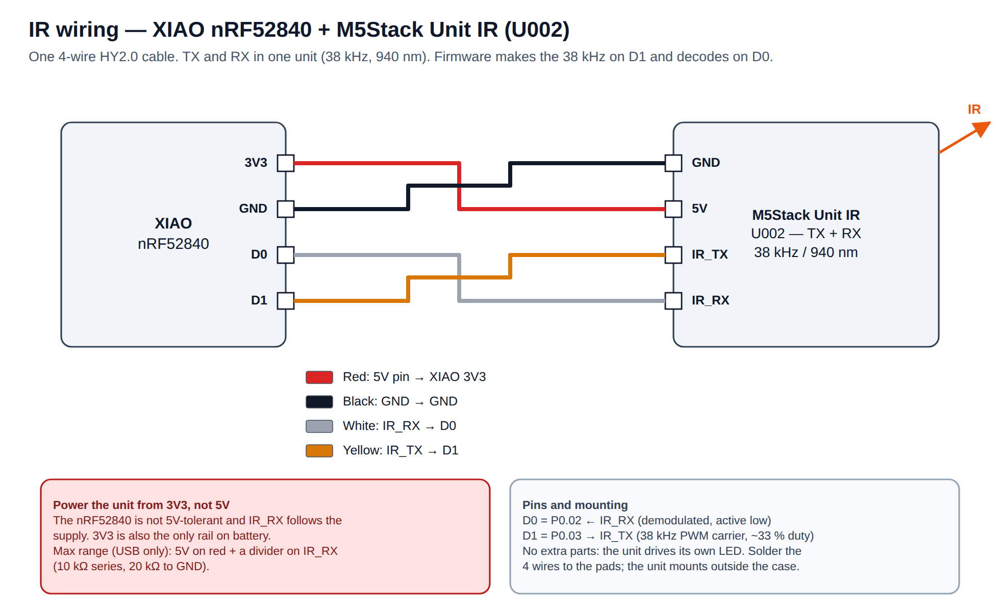

# 2 · Hardware

[← Overview](01-overview.md) · [Manual index](README.md) · [Next: Installation →](03-installation.md)

## Parts

| Part | Needed for | Notes |
|---|---|---|
| Seeed **XIAO nRF52840** (plain or Sense) | everything | the drive in bootloader mode is named `XIAO-BOOT` or `XIAO-SENSE` |
| USB-C **data** cable | everything | charge-only cables don't enumerate |
| PC with Linux (Ubuntu tested) | everything | macOS/Windows run the bridge; the flash helper is Linux/macOS-oriented |
| M5Stack **Unit IR (U002)** | IR tab, IR loopback test | TX + RX in one unit, 4-wire HY2.0 lead |
| 1-cell **LiPo 41 × 10 × 6 mm with protection PCM** | battery operation | never a bare cell — see [Battery safety](#battery-safety) |
| Printed enclosure | optional | `hardware/bt_case_base.stl` + `bt_case_lid.stl` |
| Soft pads (TPU or 1 mm silicone bumpers) | with the enclosure | carry the board above the cell |

## IR wiring

[](ir_connection.svg)

| Unit IR wire | XIAO pad | nRF52840 pin | Function |
|---|---|---|---|
| Black (GND) | GND | — | ground |
| Red (5V) | **3V3** | — | power — **not 5V** |
| Yellow (IR_TX) | D1 | P0.03 | 38 kHz carrier from the firmware (`HwPWM3`, ~33 % duty) |
| White (IR_RX) | D0 | P0.02 | demodulated receiver output, active low, internal pull-up |

- **Power from 3V3.** The nRF52840 is not 5V-tolerant and the unit's IR_RX output follows its supply.
  3V3 is also the only rail available on battery.
- **More range (USB power only):** red to 5V, and a divider on IR_RX into D0 (10 kΩ in series,
  20 kΩ to GND). TX stays direct.
- No extra parts: the unit has its own LED driver. Cut the HY2.0 lead and solder the four wires to the
  XIAO pads. The unit mounts **outside** the case, facing the remote (it needs line of sight).

## Battery and charging

The jig runs from USB alone. For portable use, solder a protected 1-cell LiPo to the `BAT+` / `BAT−`
pads under the XIAO. The on-board **BQ25101** charges it over USB-C (about 50 mA, set by an on-board
resistor — fine for a small pouch; don't raise it unless the cell's datasheet allows).

The firmware reads the cell on P0.31 through the on-board 1 MΩ / 510 kΩ divider (enabled by P0.14,
which the firmware holds LOW permanently — releasing it would push P0.31 above its safe range).

| Reading | What the jig does |
|---|---|
| ≥ 3.4 V | normal |
| < 3.4 V | `battery` event `low: true`; banner marks **LOW**, one-time warning |
| < 3.3 V | `cut: true`; **IR transmit refused** (heaviest load) until the cell is back above 3.4 V |
| < 2.5 V | treated as "no cell fitted" (USB only) — no cut |
| ~4.2 V with no cell | normal: the VBAT pin sees the charger output |

### Battery safety

The BQ25101 is a **charger, not a protection circuit**:

| Failure | Protected by | Automatic? |
|---|---|---|
| Overcharge (> 4.2 V) | BQ25101 charger | yes |
| Over-discharge | the **cell's own PCM** | only if the cell has one |
| Over-current / short | the **cell's own PCM** | only if the cell has one |
| Early low-battery warning | firmware + app (above) | yes — a soft limit, never the safety net |

Always use a cell **with** a protection PCM. The real fire risks are mechanical and manual:

1. **Reverse polarity** on `BAT+ / BAT−` — check three times before first power-up.
2. **Crushing or puncturing the pouch** — the case keeps the board on soft stand-offs above the cell and
   has a hard spacer before the USB-C slot; deburr the print.
3. **Heat on the cell body** while soldering — solder fast to the PCM leads.
4. **A swollen or damaged cell** — never charge it; dispose of it safely.

## Enclosure

| File | What |
|---|---|
| `hardware/bt_case_base.stl`, `bt_case_lid.stl` | the provided case (≈ 46 × 23 × 14 mm): pouch channel with rails, corner stand-offs ~0.3 mm above the pouch, USB-C slot, cable slot for the IR lead, flush friction lid |
| `hardware/bt_case.scad` | parametric alternative → `bt_case_param_base.stl`, `bt_case_param_lid.stl` (notched over USB-C), `bt_case_param_pads.stl` (four 3 × 3 × 1 mm pads, print in TPU) |

Re-render after editing the `.scad`:

```bash
openscad -D 'part="base"' -o hardware/bt_case_param_base.stl hardware/bt_case.scad   # likewise lid, pads
```

Check the fit against your actual board and cell before printing.

[← Overview](01-overview.md) · [Manual index](README.md) · [Next: Installation →](03-installation.md)
