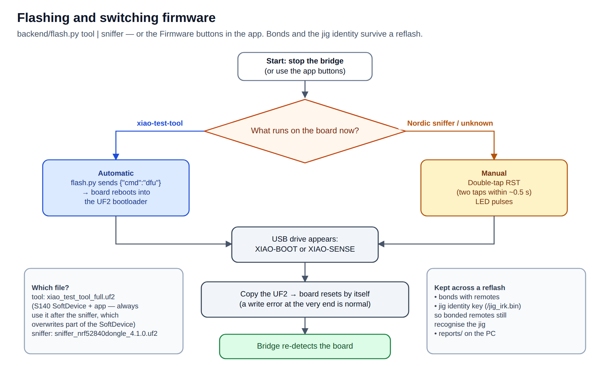

# 4 · Firmware and flashing

[← Installation](03-installation.md) · [Manual index](README.md) · [Next: Quick start →](05-quick-start.md)

## Which firmware?

| | **xiao-test-tool** | **Nordic nRF Sniffer 4.1** |
|---|---|---|
| File | `firmware/xiao_test_tool/build/xiao_test_tool_full.uf2` | `sniffer_nrf52840dongle_4.1.0.uf2` |
| Role | BLE **central**: pairs with the remote | passive **listener** |
| Sees key presses | yes, in clear text | no (link is encrypted once bonded) |
| Voice, battery, GATT, IR | yes | no |
| Front end | this web app | Wireshark / `ble_probe.py` |
| Banner in the app | **jig online** | **sniffer image** + flash button |
| Changes the remote's pairing | yes — bonds it to the jig | no |

Full decision chart: [Overview ▸ Decision chart](01-overview.md#decision-chart).

## How flashing works

The XIAO has a **UF2 bootloader**. In bootloader mode it appears as a USB drive named `XIAO-BOOT`
(or `XIAO-SENSE` on boards with the Sense bootloader); copying a `.uf2` file onto it flashes it.

[](flashing-flow.svg)

## Option A — from the web app

**Connect ▸ Log ▸ Firmware** (bottom of the Connect tab):

- **Flash Nordic sniffer (for Wireshark)** — xiao-test-tool → sniffer. Fully automatic.
- **Re-flash xiao-test-tool** — e.g. after a firmware update.

When the sniffer image is running, the banner shows **Flash xiao-test-tool**; press it and
**double-tap RST** on the XIAO when asked. Progress appears as messages; the bridge re-detects the board.

## Option B — with the helper

Stop the bridge first (it holds the serial port), then:

```bash
.venv/bin/python backend/flash.py tool       # install xiao-test-tool
.venv/bin/python backend/flash.py sniffer    # install the Nordic sniffer
```

| Starting from | What happens |
|---|---|
| xiao-test-tool | no button needed: the script sends `{"cmd":"dfu"}`, the board enters the bootloader, the copy runs |
| Nordic sniffer (or unknown) | the script says *"Double-tap the RST button"* — tap RST twice within ~0.5 s; it waits up to 3 min (`--wait 600` for longer) |

## Option C — by hand

1. Double-tap **RST** → the `XIAO-BOOT` / `XIAO-SENSE` drive appears.
2. Copy the `.uf2` onto it.
3. The board reboots by itself. A *write error* at the very end is normal — the board resets as the
   last block lands.

## Rules

- **Coming from the sniffer, always use `xiao_test_tool_full.uf2`.** The sniffer overwrites part of the
  S140 SoftDevice; the full file restores it. The app-only file would leave a board that doesn't start.
- **Kept across a reflash:** bonds with remotes, the jig's identity key (`/jig_irk.bin`, so bonded
  remotes still recognise the jig), and everything in `reports/` on the PC.
- **One image at a time.** To sniff and test simultaneously, use a second XIAO for the sniffer.
- The bridge can stay running while you flash: it notices the board leaving and coming back.

## Checking what runs

- **Web app banner:** *Board: jig online* + *Firmware: xiao-test-tool 0.2*, or *sniffer image*.
- **Bridge log:** `detected tool firmware on /dev/ttyACM0`, or a warning that the port runs the Nordic image.
- **Serial terminal** (bridge stopped): `.venv/bin/pyserial-miniterm /dev/ttyACM0 1000000`, type
  `{"cmd":"ping"}` → `{"ev":"hello","fw":"xiao-test-tool","ver":"0.2",…}`.

[← Installation](03-installation.md) · [Manual index](README.md) · [Next: Quick start →](05-quick-start.md)
