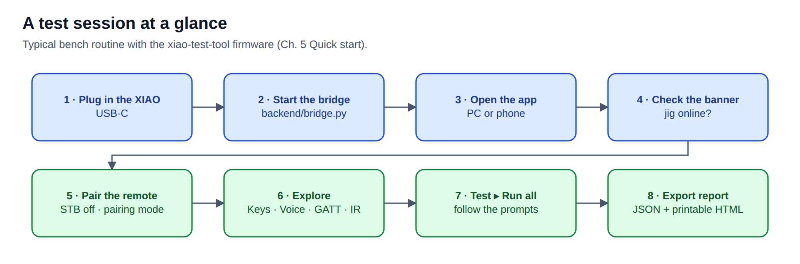
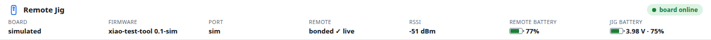
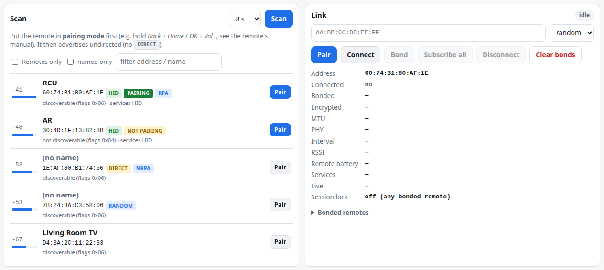
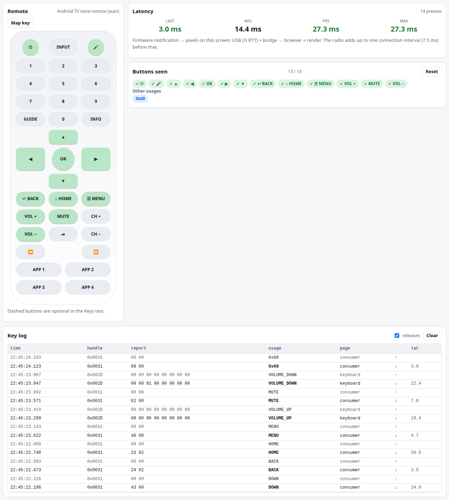

# 5 · Quick start

[← Firmware and flashing](04-firmware.md) · [Manual index](README.md) · [Next: Web app tour →](06-web-app.md)

From a fresh board to decoded key presses. Assumes [Installation](03-installation.md) is done.



## 1 · Plug in the XIAO

USB-C data cable to the PC. If it still runs the Nordic sniffer, that's fine — step 4 fixes it.

## 2 · Start the bridge

```bash
cd BT-Sniffer
.venv/bin/python backend/bridge.py
```

```
bridge: serving web app: http://localhost:8000  http://192.168.1.26:8000
bridge: detected tool firmware on /dev/ttyACM0
```

Leave it running for the whole session; replugging and reflashing are handled automatically.

## 3 · Open the app

PC: **http://localhost:8000** · phone on the same Wi-Fi: **http://&lt;PC-IP&gt;:8000**.

## 4 · Check the banner



| Banner | Meaning | Do |
|---|---|---|
| **board online** · Board **jig online** | xiao-test-tool is running | continue |
| **sniffer image** | the Nordic sniffer is flashed | press **Flash xiao-test-tool**, double-tap RST |
| **no board** | nothing detected | check the cable; `ls /dev/ttyACM*`; [Troubleshooting](10-troubleshooting.md) |
| **offline** | the page can't reach the bridge | is `bridge.py` running? same host/port? |

## 5 · Pair the remote

1. **Switch the set-top box off** (unplug it) so the remote can't reconnect to it.
2. **Connect ▸ Scan**.
3. Put the remote into **pairing mode**:
   - Android TV voice remotes: hold **Back + Home** (or **OK + Vol−**) ~5 s until the LED blinks;
   - Fire TV remotes: hold **Home** ~10 s (factory reset first if needed — [Ch. 7](07-pairing-remotes.md)).
4. The remote appears with **HID** and green **PAIRING** badges. Press its **Connect**.

   

5. When the stage shows *discovered*, press **Bond**. The stage moves *pairing → reading → **ready***;
   the XIAO's blue LED is on while connected.

## 6 · Press keys

Open **Keys** and press buttons on the remote. Each lights up on the drawing and is listed with its
decoded name and latency.



## 7 · Run the test and export

**Test ▸ Run all**, follow the prompts, then **Export report** — see [Testing and reports](08-testing-reports.md).

## Next

- Everything on each screen: [Web app tour](06-web-app.md)
- Why some remotes need pairing mode every session: [Pairing and remotes](07-pairing-remotes.md)

> **No hardware?** `.venv/bin/python backend/bridge.py --simulate` runs a simulated jig and remote,
> including keys, voice, IR and the test runner — useful for training. All screenshots in this
> manual were taken that way.

[← Firmware and flashing](04-firmware.md) · [Manual index](README.md) · [Next: Web app tour →](06-web-app.md)
