# 6 · Web app tour

[← Quick start](05-quick-start.md) · [Manual index](README.md) · [Next: Pairing and remotes →](07-pairing-remotes.md)

The app has a **banner** that is always visible and five **tabs**. All tabs work with the
xiao-test-tool firmware. Screenshots were taken with `bridge.py --simulate` (values marked
"Simulated" / "SIM-…" are from the simulator).

- [Banner](#banner) · [Connect](#connect) · [Keys](#keys) · [Voice](#voice) · [IR](#ir) · [Test](#test) · [On a phone](#on-a-phone)

## Banner

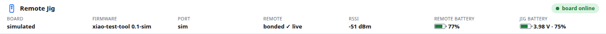

| Field | Shows |
|---|---|
| status pill | **board online** (green), **no board**, **sniffer image**, or **offline** (page can't reach the bridge) |
| Board | jig online · simulated · sniffer image · none |
| Firmware | name and version reported by the board |
| Port | serial port, e.g. `/dev/ttyACM0` |
| Remote | link state: stage, **bonded ✓**, or **silent ⚠** (connected but the remote sends nothing — [Ch. 7](07-pairing-remotes.md#silent-links)) |
| RSSI | signal strength of the remote |
| Remote battery | the remote's own Battery Service level. Hover: *read* or *notified*, and when. Dimmed "(last)" while disconnected |
| Jig battery | jig LiPo voltage and %. **LOW** below 3.4 V |

When the board runs the Nordic sniffer image, a hint with a **Flash xiao-test-tool** button appears:

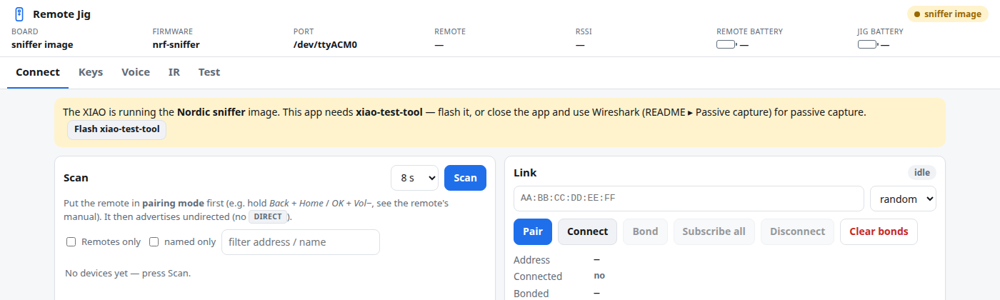

## Connect

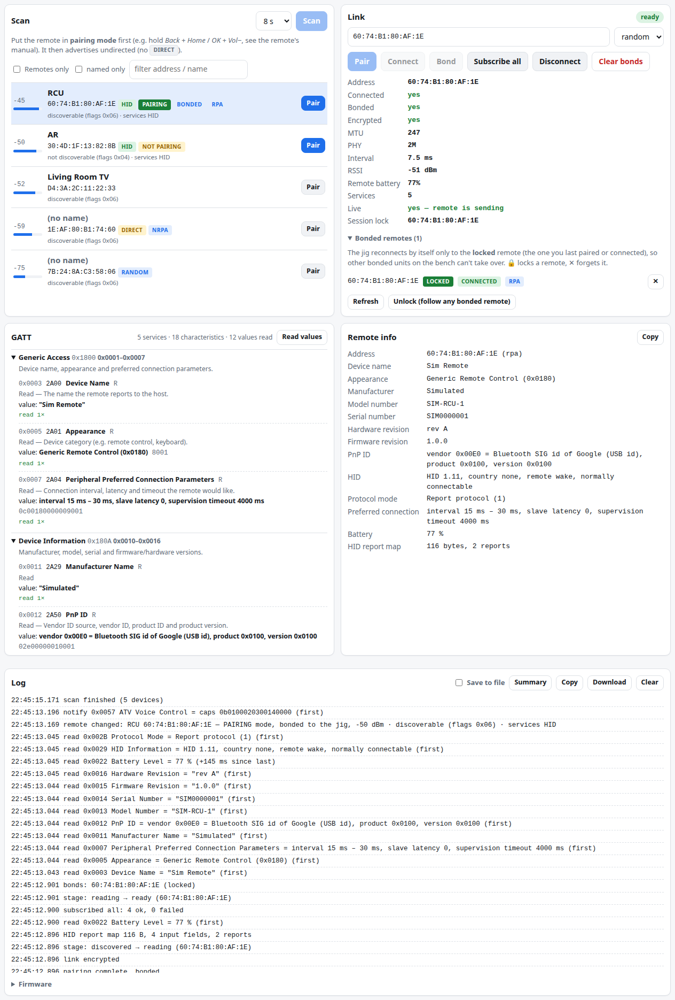

### Scan

Lists nearby BLE devices, strongest first. Badges:

| Badge | Meaning |
|---|---|
| **HID** | advertises the HID service — a keyboard/remote |
| **BONDED** | the jig holds a bond with this remote |
| **PAIRING** | its advert flags say *discoverable*: it is in pairing mode and will accept the jig |
| **NOT PAIRING** | not discoverable: it is only reconnecting to its own host and will refuse the jig (connect fails with 0x3E) |
| **DIRECT** | a directed advert aimed at one specific host |
| **RPA / RANDOM / NRPA** | address type (resolvable private, random static, non-resolvable) |

Under each name, a decoded line describes the advert: discoverable or not (flags), appearance (e.g.
Generic Remote Control), maker (Bluetooth company ID, e.g. Amazon.com Services), advertised services and
TX power. Bonded remotes sort first, then HID devices.

Filters: *Remotes only* (HID, remote/keyboard appearance, or bonded to the jig — some remotes advertise
neither HID nor an appearance), *named only*, text search. Click a row to fill the address; **Pair** on
a row pairs it in one step (below). Pressing Pair on a **NOT PAIRING** remote asks for confirmation first.

### Link

Buttons:
- **Pair** — the normal way: connect → pair → subscribe in one step. It pairs **fresh** (any old bond
  with that remote is deleted first) and retries a connection the remote misses (0x3E / timeout) twice.
- **Connect** and **Bond** — the same two steps separately, for diagnosis.
- **Subscribe all** (re-enable notifications) · **Disconnect** · **Clear bonds** (forget all remotes).

Details: address, connected, bonded, encrypted, MTU, PHY, connection interval, RSSI, remote battery,
services, **Live** (yes = the remote is sending; *unknown — press a key* for remotes the jig can't check
by itself; **SILENT**) and **Session lock**. The stage label runs *idle → connecting → connected →
discovering → discovered → pairing → reading → **ready***.

**Passkey pairing.** A remote that refuses Just Works pairing (code 0x83) gets a second attempt with a
passkey: a box shows a 6-digit code — type it on the remote and press OK / Enter.

**Bonded remotes** (expand under the details) lists every remote bonded to the jig, with **LOCKED**,
**CONNECTED** and **RPA** badges. The jig reconnects by itself **only to the locked remote** — the one
you last paired or connected — so other bonded units on the bench can't take over a session. 🔒 locks a
remote, ✕ forgets one, **Unlock** lets the jig follow any bonded remote again. The lock survives reboots.

### GATT

Everything the remote exposes, explained:

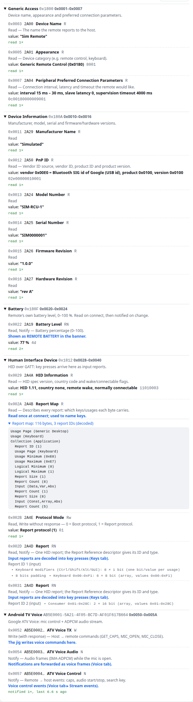

- every **service** and **characteristic** with its name and purpose;
- **properties** spelled out — R Read, W Write, w Write without response, N Notify, I Indicate;
- each readable **value**, read once per connection and **decoded** (device name, appearance,
  preferred connection parameters, Device Information strings, PnP ID, HID information, protocol mode,
  battery); raw hex beside it;
- the **HID report map** decoded — under each Report: its ID and which keys it carries;
- a **tally** per characteristic: read N×, notified N×, last seen, average interval;
- **Read values** reads everything again.

Vendor services (e.g. Amazon's) are labelled *vendor-specific*; their notifications are forwarded raw.

### Remote info

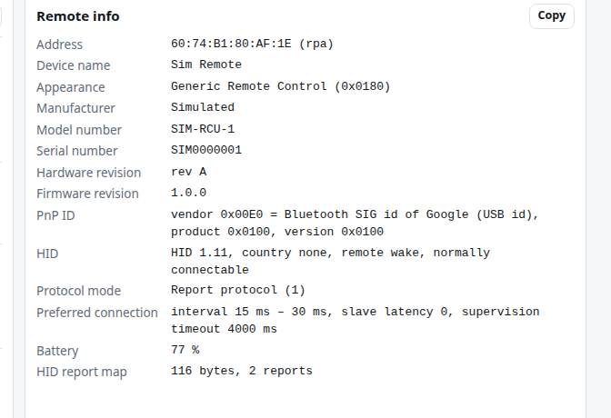

The identity of the connected remote in one list: address, name, appearance, manufacturer, model,
serial, hardware/firmware/software revision, PnP ID, System ID, regulatory data, HID version, protocol
mode, preferred connection, battery, report-map size. **Copy** puts it on the clipboard. After a
disconnect it keeps the last connection's values.

### Log

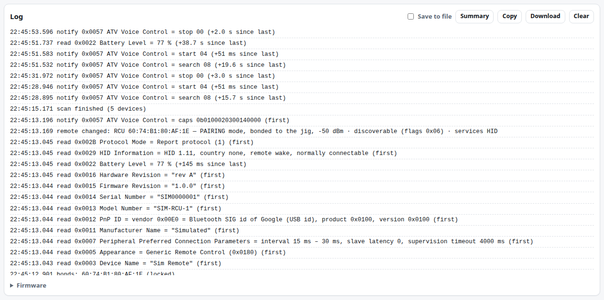

- firmware and bridge messages (connect, pairing, errors), every **stage change**
  (`stage: discovered → pairing`), **link changes** (connection interval / slave latency / supervision
  timeout, PHY, data length, MTU), **remote sightings** (first time a remote is seen and whenever it
  changes: pairing mode on/off, bonded), bond-list changes and passkey prompts;
- one line per **GATT exchange**: `read` (the jig asked) or `notify` (the remote sent it by itself),
  with the decoded value and the **time since the previous one** on that characteristic — that's how
  you see how often a remote sends something (e.g. battery updates);
- key presses and voice frames are counted in the GATT tally instead (too frequent to list);
- **Summary** — opens a live table above the log (per characteristic: reads, notifications, last seen,
  average interval) with its own **Copy**. Close it with **✕ Close**, **Hide summary** or Esc; the log
  itself is not changed;
- **Save to file** — persistent logging on the PC. Tick it and the **bridge** writes
  `reports/logs/session_<date-time>.log` in the background (a new file each time you tick it). It
  keeps going with the browser closed or the phone asleep, and every open page shows the same tick and
  file name (click the name to open the file). Each line has a timestamp: commands sent, state changes,
  decoded keys, GATT reads and notifications, battery, voice control, log messages. Voice audio is
  summarised as one line per stream; keep-alive pings and RSSI-only updates are left out. To start it
  with the bridge, use `bridge.py --session-log`.
- **Copy** / **Download** — the whole session (up to 20 000 lines, oldest first) with a header
  (date, jig firmware, port, remote address/name/model/firmware), saved as
  `remote-log_<address>_<date-time>.txt`;
- **Firmware** — switch images ([Ch. 4](04-firmware.md)).

## Keys

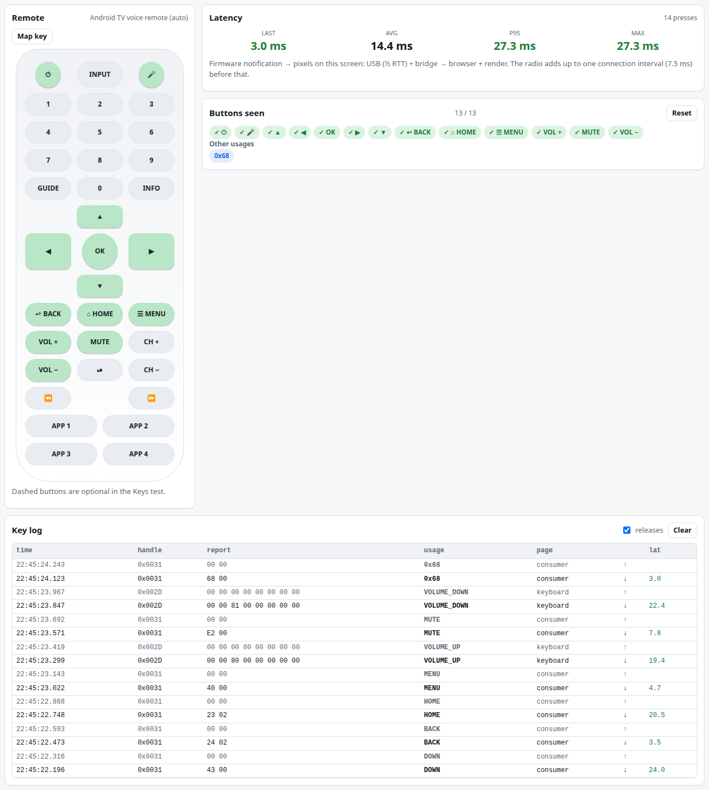

| Area | What it does |
|---|---|
| **Remote** drawing | the pressed button flashes; buttons already seen turn green. Dashed = optional in the test |
| **Latency** | last / avg / p95 / max from the firmware receiving the notification to the row on screen (USB + bridge + network + render). The radio adds up to one connection interval, shown below. < 50 ms is green |
| **Buttons seen** | checklist of expected buttons; **Other usages** collects codes not on the drawing |
| **Key log** | time, handle, raw report, decoded usage, HID page, ↓ press / ↑ release, latency. Untick *releases* to hide ↑ rows |
| **Map key** | bind a vendor code to a drawn button: press **Map key**, tap the button on the drawing, press the physical key. Saved in this browser |

**Other HID reports** (appears below the key log when needed) lists HID reports whose report map
declares **no key usages**: vendor data such as motion/pointer streams (e.g. the LG Magic Remote's 100/s
motion reports). They are never shown as keys. The panel gives each stream's count, rate and latest bytes,
highlighting bytes that changed — that is how a remote's hidden key codes are found. (LG keys are decoded
from this stream by the bridge and appear as normal keys.)

Vendor codes seen so far: Android TV voice remote app keys `0x68`, `0x72` (consumer page); Fire TV
remote `0xF1` (keyboard page, probably Back) and `0xA1`–`0xA4` (vendor report 239, probably the app
buttons) — confirm on your unit and name them with **Map key**.

## Voice

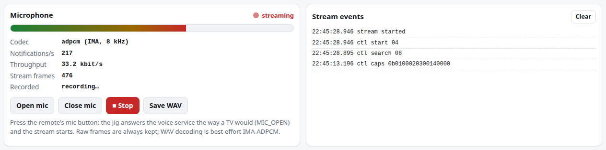

- **Hold the remote's mic button**: the jig answers the Android TV Voice service like a TV, the
  indicator turns red and the level meter, notifications/s and throughput update live.
- **Open mic** / **Close mic** send MIC_OPEN / MIC_CLOSE (hold-to-talk remotes answer MIC_OPEN with an
  error — use the button).
- **● Record** collects frames until **■ Stop**. **Save WAV** decodes IMA-ADPCM (8 or 16 kHz, detected
  from the byte rate) and offers a player, **Download WAV** and **Download raw**. The raw file is always
  kept even if decoding fails. Without a recording, Save uses the last stream.
- Files go to `reports/voice/`.

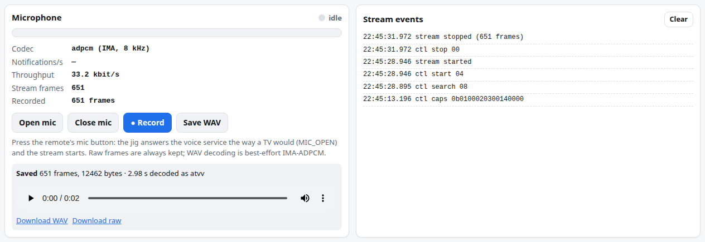

Fire TV remotes: not supported yet — their mic arrives as a `SEARCH` key and the audio uses Amazon's
own protocol ([Ch. 7](07-pairing-remotes.md#fire-tv-voice)).

## IR

Needs the Unit IR ([Hardware](02-hardware.md#ir-wiring)).

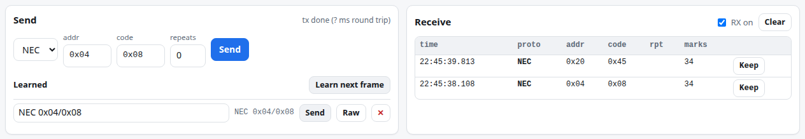

- **Receive**: every frame — protocol (NEC, SIRC, RC5, UNKNOWN), address, code, repeat flag, mark
  count. **RX on** toggles the receiver.
- **Learn next frame**, then press a key on any IR remote aimed at the unit: the frame is stored under
  **Learned** (rename, **Send**, **Raw** replays the exact timings, ✕ deletes). **Keep** on a received
  row does the same.
- **Send**: NEC or SIRC by address/code with optional repeats; the status shows when it finished.
  Refused while the jig battery is below 3.3 V.

## Test

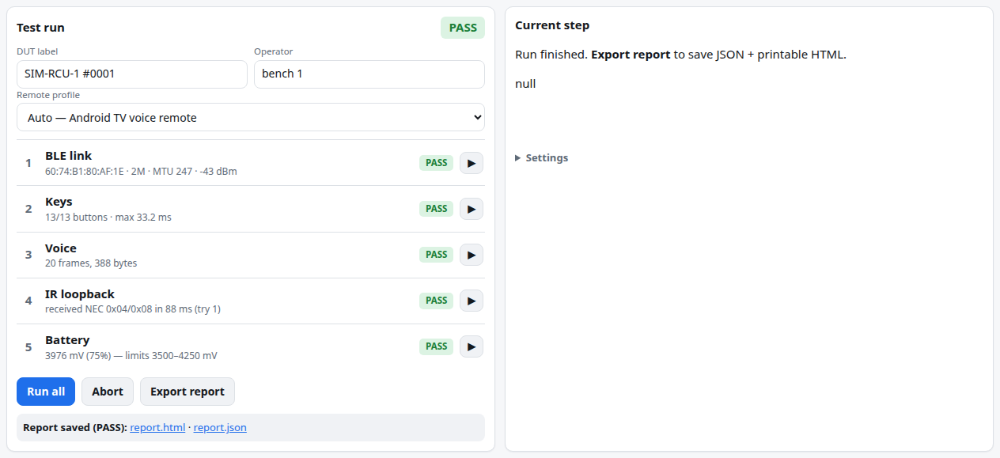

Scripted pass/fail run with report export, with a **Remote profile** per remote model — see
[Testing and reports](08-testing-reports.md).

## On a phone

The layout stacks into one column; on the Test tab the *Current step* panel comes first.

| Connect | Keys | Test |
|---|---|---|
| 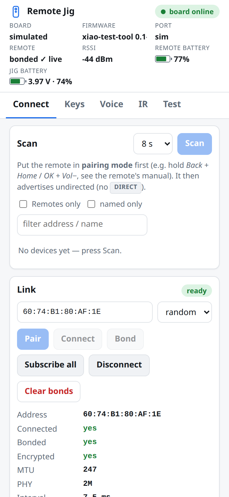 | 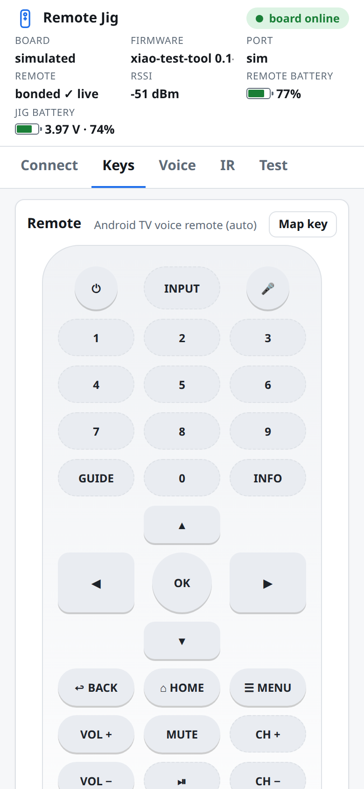 | 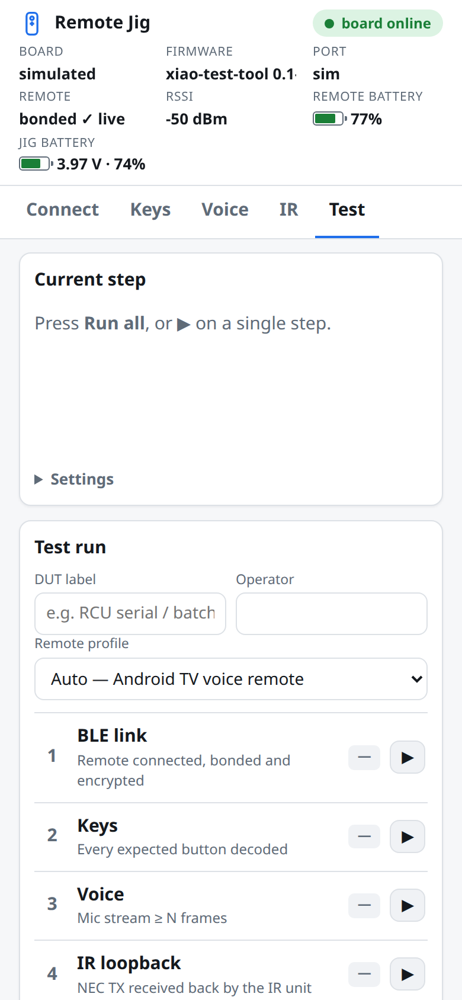 |

**Install as an app** (full screen, offline shell) — phones require HTTPS:

1. Start the bridge with `--https` (creates a local CA in `.certs/`, serves `https://<PC-IP>:8443`).
2. On the phone open `http://<PC-IP>:8000/ca.crt` and install it:
   - Android: Settings ▸ Security ▸ Encryption & credentials ▸ Install a certificate ▸ CA certificate;
   - iOS: install the profile (Settings ▸ General ▸ VPN & Device Management), then enable it under
     Settings ▸ General ▸ About ▸ Certificate Trust Settings.
3. Open `https://<PC-IP>:8443` → *Install app* (Chrome) or *Share ▸ Add to Home Screen* (Safari).

Only install this CA on devices you control; delete `.certs/` to make a new one. The app always loads
the latest version from the bridge and falls back to its cached copy only when the bridge is offline.

[← Quick start](05-quick-start.md) · [Manual index](README.md) · [Next: Pairing and remotes →](07-pairing-remotes.md)
