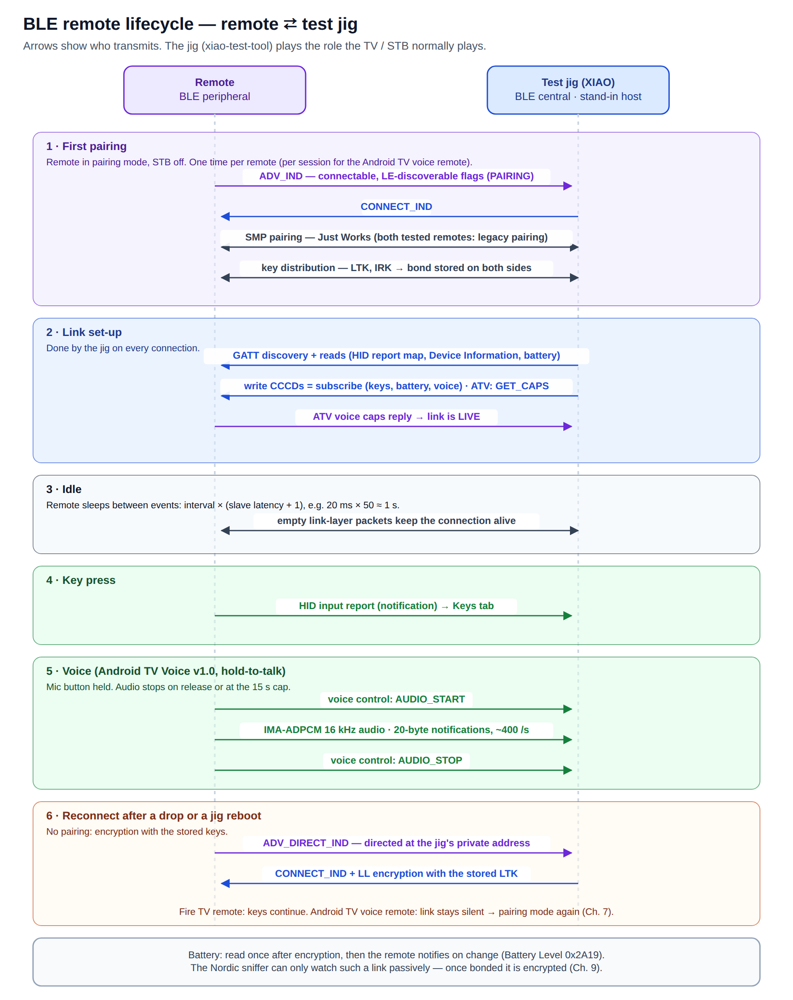
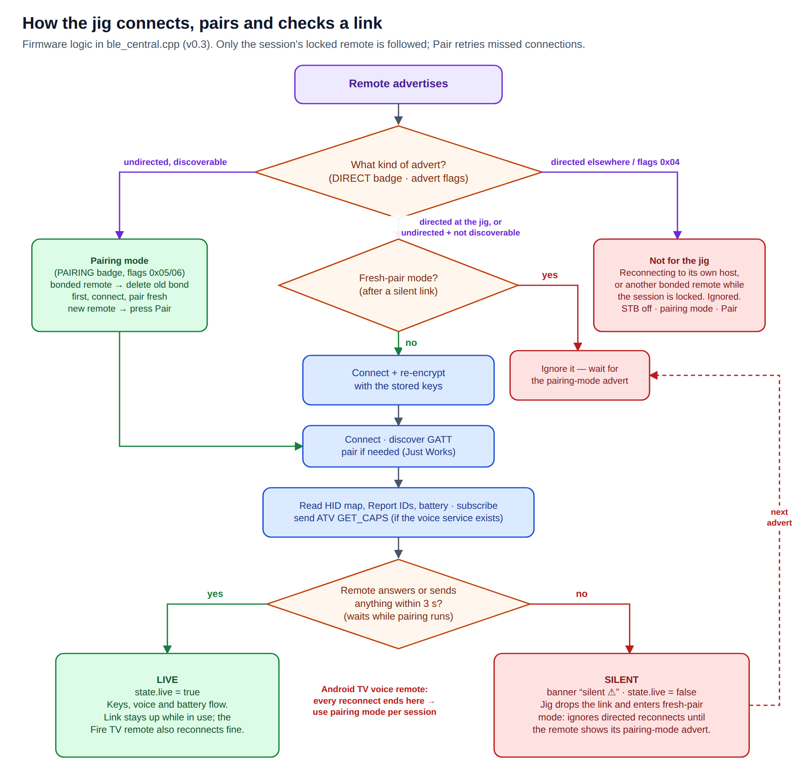

# 7 · Pairing and remotes

[← Web app tour](06-web-app.md) · [Manual index](README.md) · [Next: Testing and reports →](08-testing-reports.md)

The jig only sees key presses in clear text because it **pairs with the remote itself**, taking the
TV's place. This chapter explains pairing, what happens afterwards, and how different remotes behave.

> **Pairing bonds the remote to the jig.** Many remotes remember only one host; pair the remote with
> its set-top box again after testing if needed.

## What happens over the air

1. **First pairing** — remote in pairing mode advertises (connectable, *discoverable*); the jig connects
   and pairs (Just Works — no PIN). Both sides store the keys (the *bond*). Both tested remotes used
   legacy pairing.
2. **Link set-up** (every connection) — the jig reads the GATT table, HID report map, Device
   Information and battery, subscribes to notifications, and, if the remote has the Android TV Voice
   service, sends `GET_CAPS`. A working link answers at once.
3. **Idle** — the link stays up; the remote sleeps between connection events.
4. **Key press** — a HID input report notification → Keys tab.
5. **Voice** — mic held: AUDIO_START, ADPCM audio, AUDIO_STOP.
6. **Reconnect** — after a drop or a jig reboot, the remote calls the jig back (*directed* advert to
   the jig's private address) and the link is encrypted with the stored keys — no pairing.

## Pairing a remote

1. **Switch the set-top box off.** Otherwise the remote may reconnect to it instead.
2. **Connect ▸ Scan.**
3. Put the remote into **pairing mode** and keep it within ~1 m:

   | Remote | Pairing mode |
   |---|---|
   | Android TV voice remotes | hold **Back + Home** (or **OK + Vol−**) ~5 s until the LED blinks |
   | Fire TV remotes | hold **Home** ~10 s. Still **NOT PAIRING**? Factory-reset: hold **Left + Menu + Back** 12 s, release, wait 5 s, then hold **Home** |
   | others | see the remote's manual; usually a two-key combination held 3–10 s |

4. Wait for the green **PAIRING** badge — **NOT PAIRING** means it is still trying to reach its own
   host and the jig's connection will fail (0x3E). Press the row's **Pair**.
5. The jig connects (retrying twice if the remote misses the connection — common), pairs (Just Works;
   a passkey fallback if the remote insists), reads the remote and subscribes. The log shows each stage.
6. **ready** = bonded ✓, encrypted ✓, report map read, notifications on. Blue LED on. The banner shows
   **bonded ✓ live** once the remote has sent something (or *press a key* for remotes the jig can't check).
7. The remote is now the session's **locked** remote: the jig follows only it.

**Connect** + **Bond** still exist for diagnosis; Pair is the same with retries and always pairs fresh.

## How the firmware handles links

| The remote advertises… | The jig… |
|---|---|
| undirected + discoverable (flags 0x05/0x06), **unknown** remote | nothing automatic — press **Pair** |
| undirected + discoverable, **bonded** remote (pairing mode) | deletes the old bond **before** connecting, then connects and pairs fresh |
| directed **at the jig**, or undirected + connectable but **not** discoverable (reconnect) | connects and re-encrypts with the stored keys — unless in *fresh-pair mode* (below) |
| directed at **another host**, or not connectable | ignores it; logs that the remote is reconnecting to its own host |
| anything from a bonded remote that is **not the locked one** | ignores it; logs "session is locked to another remote" |

Rules that keep bonds safe:
- Only the **advert** decides (not the scan response), and only its **Flags** say "pairing mode". A
  remote waking up with an ordinary undirected advert is reconnected with its keys, not re-paired.
- The old bond is deleted **before** a fresh pairing connects: Bluefruit re-encrypts with any stored
  bond the instant a link opens, which would otherwise win over the new pairing.
- Bonds are deleted by the remote's **identity** address, so remotes using private (RPA) addresses are
  handled too.
- A bond is dropped after a failed re-encryption only for "the remote has no keys for us" reasons
  (0x13, 0x05, 0x06, 0x0E, 0x3D) — never for a lost radio link (0x08).

## Remotes differ on reconnect

| Remote | After a drop / jig reboot | What you do |
|---|---|---|
| **Fire TV remote** (30:4D:1F:13:82:8B) | reconnects with the stored keys and **keeps sending** keys and battery | press any key to wake it |
| **Android TV voice remote** (60:74:B1:80:AF:1E) | reconnects and encrypts, but **sends nothing** | pairing mode at the start of every session |

### Silent links

On the Android TV voice remote, only a link made by a **fresh pairing** works. A reconnected link
looks healthy — encrypted, subscriptions accepted — but carries no keys, no voice and no reply to the
voice handshake. Re-pairing over such a link does not help either. A freshly paired link, on the other
hand, stays up for as long as you use it (more than 7 minutes idle was observed).

The firmware detects and handles this automatically (only for remotes with the Android TV Voice
service — others are marked live on their first notification):

1. **Check** — ~3 s after `GET_CAPS` (longer while pairing is still exchanging keys) with no reply:
   `state.live = false`, banner **silent ⚠**, a warning; the jig **drops the link**.
2. **Fresh-pair mode** — the jig ignores the remote's directed reconnects (they would only produce
   another silent link and keep the remote out of real pairing mode).
3. **Pairing mode** — on the remote's undirected advert, the jig deletes the old bond first and pairs
   fresh (otherwise the Bluetooth stack would answer with the old keys and the link would be silent again).

**In practice:** STB off, remote in pairing mode, wait for **bonded ✓** — and when the banner ever
shows **silent ⚠**, just put the remote in pairing mode again. No app buttons needed.

After a jig reboot with **no** bond stored (e.g. after **Clear bonds**), the jig does not scan by
itself — use **Scan → Connect → Bond**.

## LG Magic Remote

Tested 2026-10-29 (F4:83:2C:6F:C4:98). Pairs and reconnects normally. It needs special handling for its keys:

- Its HID report map declares every report as an **opaque byte array** (Consumer page, values 0–255,
  no usage list), so a standard decoder finds no key codes in it.
- It streams **~100 reports/s** of motion data (report 0xFD, 19 bytes: six 16-bit gyro/accelerometer
  values) for the on-screen pointer. These appear under **Keys ▸ Other HID reports**, not as keys.
- Its **keys travel inside that stream**: byte 16 bit 7 = a key is held, byte 17 = the key code. The
  codes are **LG's TV infrared command codes**. The bridge decodes them (`backend/lg_magic.py`) into
  ordinary key events.

| Confirmed on the remote | Code |
|---|---|
| OK, Up, Down, Left, Right | 0x44, 0x40, 0x41, 0x07, 0x06 |
| Back, Home, Settings | 0x28, 0x7C, 0x43 |
| Volume +/−, Channel +/− | 0x02, 0x03, 0x00, 0x01 |

Other codes seen but not yet tied to a button: 0x0C, 0x3E, 0x48, 0x56, 0x5C, 0x81, 0x8B, 0xA1, 0xAE
(likely mic, mute, input, number pad and app shortcuts). They show as `LG_0x..`; bind them with
**Keys ▸ Map key**, or add them to `LG_KEYS` in `backend/lg_magic.py`. LG voice is not supported.

## Fire TV voice

The Fire TV remote's mic button arrives as a `SEARCH` key (consumer usage 0x221). Its audio uses
Amazon's own GATT services, whose start command is not public:

- `FE151500-5E8D-11E6-8B77-86F30CA893D3`
- `5DE20000-5E8D-11E6-8B77-86F30CA893D3`
- `CFBFA000-762C-4912-A043-20E3ECDE0A2D`

The jig subscribes to them and forwards any notification as raw voice frames, but the remote waits for
a command it doesn't receive. The way forward is a Wireshark capture of a real Fire TV ⇄ remote voice
session that includes the pairing ([Passive capture](09-passive-capture.md)).

## Bonds and the session lock

**Connect ▸ Link ▸ Bonded remotes** lists every remote bonded to the jig (up to 16). The jig follows
only the **locked** remote — set automatically by Pair / Connect, or with 🔒. With several units on the
bench, a stray key press on an earlier unit is ignored (and logged) instead of taking over the jig; if a
different remote does connect during a test run, the run and the report flag it.

- ✕ forgets one remote; **Clear bonds** forgets all (and unlocks).
- **Unlock** lets the jig follow any bonded remote again.
- Bonds and the lock survive reboots and reflashing.

## Addresses

Shown most-significant byte first (standard Bluetooth order). Old `ble_probe.py` output and
`BT-sniffed.txt` printed them byte-reversed (e.g. `1E:AF:80:B1:74:60` for `60:74:B1:80:AF:1E`); fixed.

[← Web app tour](06-web-app.md) · [Manual index](README.md) · [Next: Testing and reports →](08-testing-reports.md)
