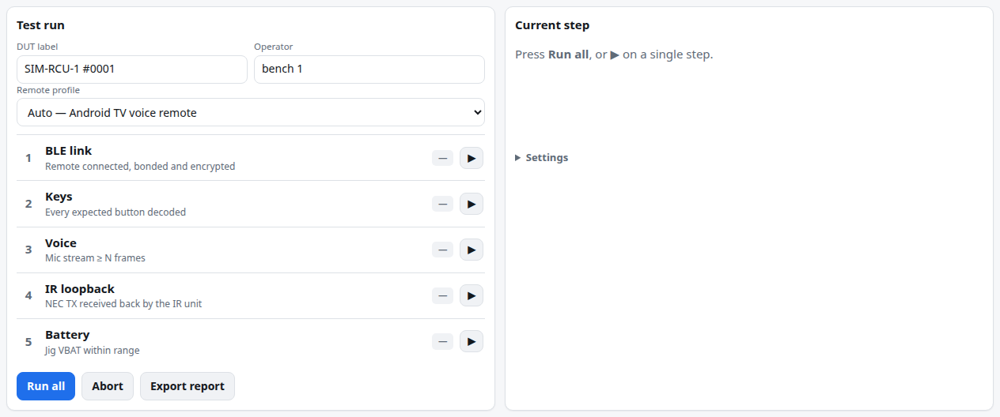
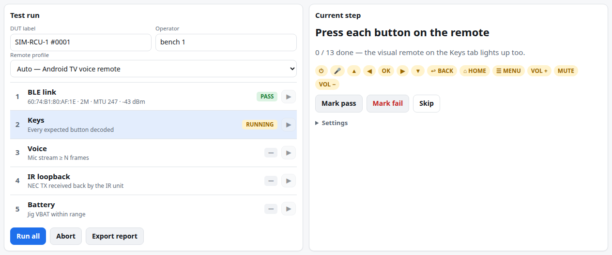
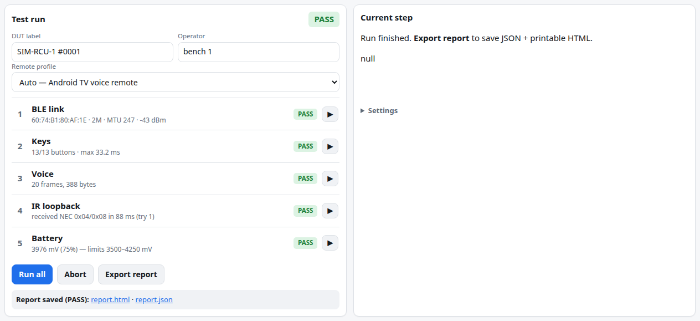

# 8 · Testing and reports

[← Pairing and remotes](07-pairing-remotes.md) · [Manual index](README.md) · [Next: Passive capture →](09-passive-capture.md)

The **Test** tab runs a scripted pass/fail check of one remote (the *DUT*, device under test) and the
jig, and exports a report.

## Before you start

- Remote paired: banner shows **bonded ✓** ([Pairing](07-pairing-remotes.md)).
- For the IR step: Unit IR wired and a white card or other reflective surface ready.

## Running

1. **Test** tab → fill **DUT label** (e.g. the remote's serial number — **Connect ▸ Remote info**
   has it) and **Operator**.

   

2. Check the **Remote profile** — it decides which buttons are expected and how voice is tested.
   *Auto* picks it from the connected remote's GATT services:

   | Profile | Expected buttons | Voice |
   |---|---|---|
   | Android TV voice remote | the drawing's solid buttons (power, mic, D-pad, OK, back, home, menu, volume, mute) | Android TV Voice stream |
   | Fire TV remote | mic, D-pad, OK, back (0xF1), home, menu, ⏪ ⏯ ⏩, volume, mute; app keys 0xA1–0xA4 mapped | *n/a* (Amazon's protocol is not supported yet) |
   | LG Magic Remote | D-pad, OK, back, home, volume, channel (keys decoded from its data stream) | *n/a* |
   | Generic BLE HID remote | D-pad, OK, back, home, volume | *n/a* |

   The Keys tab shows the active profile next to the drawing.
3. Optional: **Settings** (in the *Current step* panel) — limits and timeouts, below.
4. **Run all**. Follow the **Current step** panel (shown first on phones):

   

| # | Step | What you do | Pass when |
|---|---|---|---|
| 1 | BLE link | nothing | remote connected and encrypted, and not silent |
| 2 | Keys | press every button listed (they tick off as they arrive) | every expected button decoded, and max latency ≤ limit |
| 3 | Voice | hold the mic button and speak | a voice stream of ≥ N frames arrives (*n/a* — skipped — for profiles without supported voice) |
| 4 | IR loopback | hold a white card a few cm in front of the Unit IR (TX and RX share it) | the transmitted NEC frame is received back |
| 5 | Battery | nothing | jig battery voltage within limits |

- Each step also offers **Mark pass**, **Mark fail** and **Skip** for operator judgement; **▶** reruns
  one step; **Abort** stops the run.
- If a **different remote** connects during the run, a warning appears and the report records the
  address change.
- Run start and finish (with the verdict) are written to the **session log** as `note` lines, as is
  every saved report — so a report and its log always match.
- Verdict: **PASS** when every step that ran passed, **FAIL** if any failed. **Skipped** steps don't
  count either way (the report lists them as *skip*); a run where everything was skipped is *incomplete*.

## Settings

| Setting | Default | Used by |
|---|---|---|
| Battery min / max mV | 3500 / 4250 | Battery |
| Voice min frames | 20 | Voice |
| Voice timeout s | 20 | Voice |
| Keys timeout s | 180 | Keys |
| Key latency max ms | 50 | Keys |
| IR addr / code | 0x04 / 0x08 | IR loopback |
| IR timeout ms / tries | 1500 / 3 | IR loopback |

## Exporting the report

**Export report** → the bridge writes `reports/report_<date-time>.json` and `.html`; links appear under
the steps. Open the HTML and print it (or *Save as PDF*) for the record. The JSON holds the same data
for scripts: `title`, `started` / `finished`, `jig` (bridge and firmware info), `dut` (label, address,
link details, battery, **profile**, **identity** — manufacturer, model, serial, hardware / firmware /
software revision, PnP ID, System ID, HID info … as in Connect ▸ Remote info — and **address_changes**),
`operator`, `notes` (address-change warning, session-log file name), `verdict`, and `steps[]` with `id`, `name`, `status` (pass / fail / skip),
`detail`, `metrics` (latencies, frame counts, voltages) and timestamps.

Other files the jig writes:

| File | From |
|---|---|
| `reports/voice/voice_<date-time>.wav` / `.bin` | Voice ▸ Save WAV (decoded / raw) |
| `remote-log_<address>_<date-time>.txt` | Connect ▸ Log ▸ Download (your browser's download folder) |
| `reports/logs/session_<date-time>.log` | Connect ▸ Log ▸ **Save to file** (persistent, written by the bridge) |

## Tips for production use

- Use one browser per bench; the bridge serves several, but all see the same jig.
- **Remote info ▸ Copy** gives model, serial and firmware for your records.
- Put each new DUT in pairing mode with the STB off; the jig pairs it fresh.
- **Clear bonds** between DUTs if you don't want the jig to keep following earlier remotes.

[← Pairing and remotes](07-pairing-remotes.md) · [Manual index](README.md) · [Next: Passive capture →](09-passive-capture.md)
