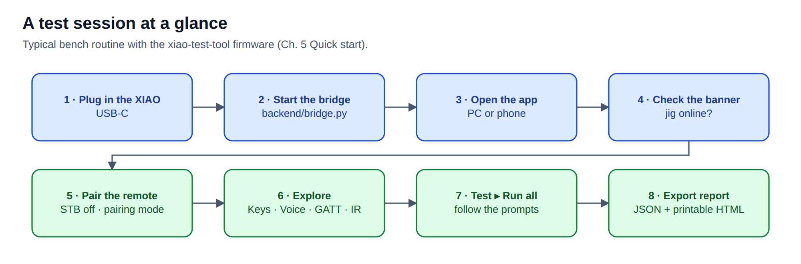
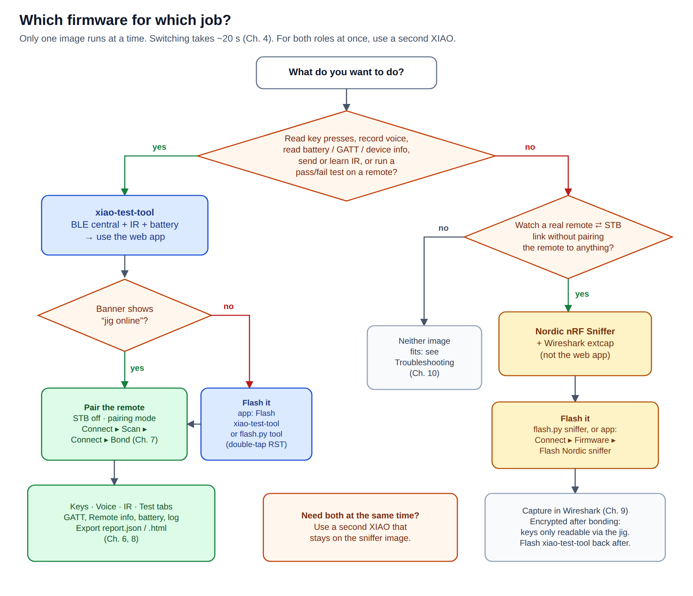

# Remote Test Jig — User Manual

A bench test suite for TV remotes (BLE voice remotes and IR remotes), built on one
**Seeed XIAO nRF52840**, a small Python bridge on a PC, and a web app for a PC or phone.

## Start here

| If you want to… | Read |
|---|---|
| understand what the system is and **which firmware to use for which job** | [1 · Overview](01-overview.md) |
| wire the IR unit, fit a battery, print the case | [2 · Hardware](02-hardware.md) |
| install the software on a PC | [3 · Installation](03-installation.md) |
| flash or switch firmware | [4 · Firmware and flashing](04-firmware.md) |
| get from zero to decoded key presses in 10 minutes | [5 · Quick start](05-quick-start.md) |
| learn every screen of the web app | [6 · Web app tour](06-web-app.md) |
| pair a remote; understand reconnects and "silent" links | [7 · Pairing and remotes](07-pairing-remotes.md) |
| run the pass/fail test and export a report | [8 · Testing and reports](08-testing-reports.md) |
| watch a real remote ⇄ STB link in Wireshark | [9 · Passive capture](09-passive-capture.md) |
| fix a problem | [10 · Troubleshooting](10-troubleshooting.md) |
| look up the serial protocol, CLI options, pins and files | [11 · Reference](11-reference.md) |

## The one decision that matters

The XIAO runs **one of two firmware images**:

| Firmware | Use it to… | Front end |
|---|---|---|
| **xiao-test-tool** (built from this repo) | pair with a remote and read **keys, voice, battery, GATT/device info**; send/learn **IR**; run the **pass/fail test** | this web app |
| **Nordic nRF Sniffer 4.1** | **passively watch** a real remote ⇄ STB link without touching it | Wireshark |

## Figures in this manual

| Figure | Shows |
|---|---|
| [architecture](architecture.svg) | how the remote, XIAO, PC bridge and browsers connect — for both firmware images |
| [firmware-decision](firmware-decision.svg) | which firmware for which job |
| [flashing-flow](flashing-flow.svg) | switching images through the UF2 bootloader |
| [pairing-flow](pairing-flow.svg) | the firmware's connect / pair / silent-link logic |
| [remote_lifecycle_sequence](remote_lifecycle_sequence.svg) | what goes over the air between remote and jig |
| [ir_connection](ir_connection.svg) | wiring the M5Stack Unit IR |
| [workflow](workflow.svg) | a test session at a glance |

Every figure exists as `.svg` (scalable, for screens) and `.png` (2×, for documents and printing).
Screenshots are in [`images/`](images/). How to regenerate both: [`src/README.md`](src/README.md).

**PDF:** the whole manual as one printable file —
`python3 doc/src/make_pdf.py` → [`Remote-Test-Jig-User-Manual.pdf`](Remote-Test-Jig-User-Manual.pdf).

The top-level [`README.md`](../README.md) is the condensed operator guide; this manual is the full version.
